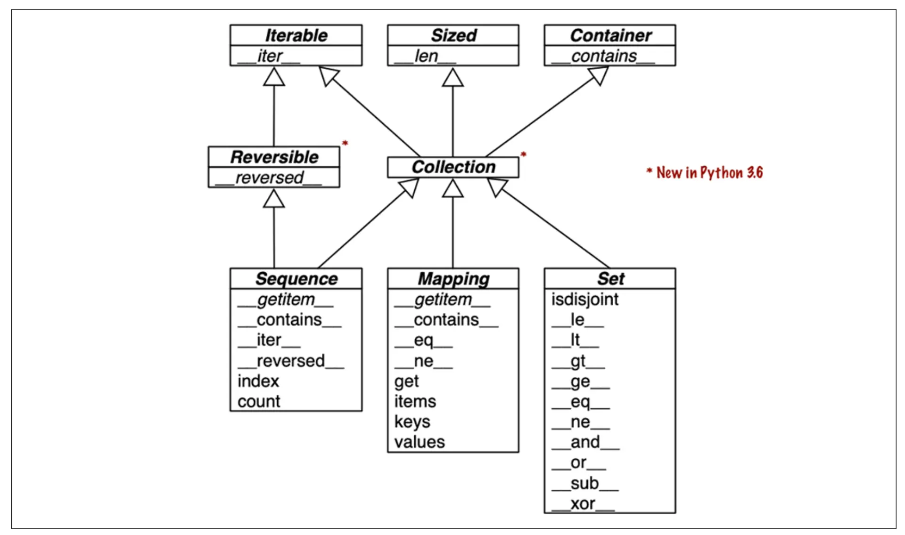

# 第一部分：Python 数据结构

!!! Abstract "Outline"

    - [x] [一、Python 数据模型](#chapter-1)
    - [x] [二、序列](#chapter-2)
    - [x] [三、字典和集合](#chapter-3)
    - [x] [四、Unicode 文本和字节序列](#chapter-4)
    - [x] [五、数据类构建器](#chapter-5)
    - [x] [六、对象引用、可变性和回收](#chapter-6)

## 一、Python 数据模型 { #chapter-1 }

???+ Abstract "Outline of Chapter 1"

    - [x] [1.1 数据模型和特殊方法](#chapter-1-data-model)
    - [x] [1.2 序列协议与运算符重载](#chapter-1-sequence-operator)
    - [x] [1.3 表示、真值和容器接口](#chapter-1-repr-bool-container)

### 1.1 数据模型和特殊方法 { #chapter-1-data-model }

Python 数据模型/Data Model 是 Python 语言本身暴露出来的一组协议。解释器并不是通过“某个类继承了某个基类”来判断对象能不能被 `#!python len()`、`#!python []`、`#!python for`、`#!python +`、`#!python with` 或 `#!python await` 使用，而是通过一组特殊方法/Special Method 来调用对象已经声明好的行为。特殊方法两端都有双下划线，因此也常被叫作 Dunder Method，行话有时候也叫其为魔法方法/Magic Method，例如 `#!python obj[key]` 背后对应的是 `#!python obj.__getitem__(key)`，`#!python len(obj)` 背后对应的是 `#!python obj.__len__()`。

**特殊方法是写给解释器调用的**。我们写 `#!python len(obj)`、`#!python iter(obj)`、`#!python str(obj)`，而不是 `#!python obj.__len__()`。而我们代码里唯一常见的直接调用，是在 `#!python __init__` 里用 `#!python super().__init__()` 调用父类的初始化方法。很多调用还是隐式的，比如 `#!python for i in x` 背后执行的是 `#!python iter(x)`，它先找 `#!python x.__iter__()`，找不到再退回 `#!python x.__getitem__()`。

通过内置函数调用还有一个好处：遇到内置类型，解释器可以走捷径。`#!python list`、`#!python bytearray` 这类用 C 实现的变长对象把长度存在结构体的 `#!python ob_size` 字段里，`#!python len()` 直接读这个字段，比调用方法快得多。这也是 `#!python len` 没有做成方法的原因：取长度太常用了，必须足够快，所以 `#!python len` 和 `#!python abs` 一样被特殊对待，可以把它们看成一元运算符；`#!python __len__` 则让自定义对象也能用 `#!python len()`，这样效率和一致性都照顾到了。

### 1.2 序列协议与运算符重载 { #chapter-1-sequence-operator }

一个最小的序列对象只要实现 `#!python __len__` 和 `#!python __getitem__`，就能自然获得很多 Python 语言能力。下面的纸牌类用 `#!python namedtuple` 表示单张牌，用一个列表保存 52 张牌：

```py
import collections

Card = collections.namedtuple("Card", ["rank", "suit"])

class FrenchDeck:
    ranks = [str(n) for n in range(2, 11)] + list("JQKA")
    suits = "spades diamonds clubs hearts".split()

    def __init__(self):
        self._cards = [Card(rank, suit) for suit in self.suits
                                        for rank in self.ranks]

    def __len__(self):
        return len(self._cards)

    def __getitem__(self, position):
        return self._cards[position]
```

`#!python deck = FrenchDeck()` 之后，`#!python len(deck)` 得到 `#!python 52`，`#!python deck[0]`、`#!python deck[-1]` 取出首尾两张牌。想随机抽一张也不用另写方法，标准库的 `#!python random.choice` 对任何序列都能用。这就是遵守数据模型的好处：用这个类的人不用去猜取长度到底叫 `#!python .size()` 还是 `#!python .length()`，我们也能直接复用标准库，不用自己造轮子。

更多能力是顺带得到的。`#!python __getitem__` 把工作交给了 `#!python self._cards` 的 `#!python []`，所以切片也能用：`#!python deck[12::13]` 从第 13 张开始每隔 13 张取一张，正好是四张 A。有了 `#!python __getitem__`，`#!python for card in deck` 和 `#!python reversed(deck)` 也能工作，迭代会从 0 开始逐个按索引取值。`#!python in` 在没有 `#!python __contains__` 时会顺序扫描，所以 `#!python Card("Q", "hearts") in deck` 也成立。排序只需要再写一个计算排序键的函数：

```py
suit_values = dict(spades=3, hearts=2, diamonds=1, clubs=0)

def spades_high(card):
    rank_value = FrenchDeck.ranks.index(card.rank)
    return rank_value * len(suit_values) + suit_values[card.suit]

sorted(deck, key=spades_high)  # 从梅花 2 排到黑桃 A
```

`#!python FrenchDeck` 只隐式继承了 `#!python object`，这些能力都不是继承来的：两个特殊方法让它表现得像标准序列，组合让这两个方法把实际工作交给内部的列表。不过它现在还不能洗牌，因为除了直接去改 `#!python _cards`，没有办法改变牌的位置；[13.2](./3_class.md#chapter-13-duck-typing-fail-fast) 会给它补上 `#!python __setitem__`。

数值类型也通过特殊方法接入运算符。下面的二维向量类实现了 `#!python abs()`、真值判断、加法和数乘：

```py
import math

class Vector:
    def __init__(self, x=0, y=0):
        self.x = x
        self.y = y

    def __repr__(self):
        return f"Vector({self.x!r}, {self.y!r})"

    def __abs__(self):
        return math.hypot(self.x, self.y)

    def __bool__(self):
        return bool(abs(self))

    def __add__(self, other):
        return Vector(self.x + other.x, self.y + other.y)

    def __mul__(self, scalar):
        return Vector(self.x * scalar, self.y * scalar)

    def __rmul__(self, scalar):
        return self * scalar
```

`#!python v1 + v2` 会调用 `#!python v1.__add__(v2)`，`#!python v * 3` 会调用 `#!python v.__mul__(3)`。`#!python 3 * v` 就不一样了：`#!python int` 的乘法不认识 `#!python Vector`，左操作数不支持对应操作，于是 Python 转而调用右操作数的反向方法 `#!python v.__rmul__(3)`。注意 `#!python __add__` 和 `#!python __mul__` 都返回新的 `#!python Vector`，不改动任何一个操作数，中缀运算符一般都应该这样。运算符分派的完整规则见[第十六章](./3_class.md#chapter-16)。

下面是 Python 特殊方法的列表：

???- Info "Python 特殊方法"

    首先是不包含运算符的特殊方法：

    - 字符串与字节表示：`#!python __repr__`、`#!python __str__`、`#!python __format__`、`#!python __bytes__`、`#!python __fspath__`；
    - 数值转换：`#!python __bool__`、`#!python __complex__`、`#!python __int__`、`#!python __float__`、`#!python __hash__`、`#!python __index__`；
    - 容器协议：`#!python __len__`、`#!python __getitem__`、`#!python __setitem__`、`#!python __delitem__`、`#!python __contains__`；
    - 迭代协议：`#!python __iter__`、`#!python __aiter__`、`#!python __next__`、`#!python __anext__`、`#!python __reversed__`；
    - 可调用对象与协程：`#!python __call__`、`#!python __await__`；
    - 上下文管理：`#!python __enter__`、`#!python __exit__`、`#!python __aenter__`、`#!python __aexit__`；
    - 对象创建和销毁：`#!python __new__`、`#!python __init__`、`#!python __del__`；
    - 属性访问：`#!python __getattr__`、`#!python __getattribute__`、`#!python __setattr__`、`#!python __delattr__`、`#!python __dir__`；
    - 描述符：`#!python __get__`、`#!python __set__`、`#!python __delete__`、`#!python __set_name__`；
    - 抽象基类：`#!python __instancecheck__`、`#!python __subclasscheck__`；
    - 类元编程：`#!python __prepare__`、`#!python __init_subclass__`、`#!python __class_getitem__`、`#!python __mro_entries__`。

    下面是包含运算符的特殊方法：

    - 一元运算：`#!python __neg__`（`#!python -`）、`#!python __pos__`（`#!python +`）、`#!python __abs__`（`#!python abs()`）；
    - 比较运算：`#!python __lt__`（`#!python <`）、`#!python __le__`（`#!python <=`）、`#!python __eq__`（`#!python ==`）、`#!python __ne__`（`#!python !=`）、`#!python __gt__`（`#!python >`）、`#!python __ge__`（`#!python >=`）；
    - 算术运算：`#!python __add__`（`#!python +`）、`#!python __sub__`（`#!python -`）、`#!python __mul__`（`#!python *`）、`#!python __truediv__`（`#!python /`）、`#!python __floordiv__`（`#!python //`）、`#!python __mod__`（`#!python %`）、`#!python __matmul__`（`#!python @`）、`#!python __divmod__`（`#!python divmod()`）、`#!python __round__`（`#!python round()`）、`#!python __pow__`（`#!python **` 或 `#!python pow()`）；
    - 反向算术运算（交换操作数）：`#!python __radd__`、`#!python __rsub__`、`#!python __rmul__`、`#!python __rtruediv__`、`#!python __rfloordiv__`、`#!python __rmod__`、`#!python __rmatmul__`、`#!python __rdivmod__`、`#!python __rpow__`；
    - 增强赋值算术运算：`#!python __iadd__`（`#!python +=`）、`#!python __isub__`（`#!python -=`）、`#!python __imul__`（`#!python *=`）、`#!python __itruediv__`（`#!python /=`）、`#!python __ifloordiv__`（`#!python //=`）、`#!python __imod__`（`#!python %=`）、`#!python __imatmul__`（`#!python @=`）、`#!python __ipow__`（`#!python **=`）；
    - 位运算：`#!python __and__`（`#!python &`）、`#!python __or__`（`#!python |`）、`#!python __xor__`（`#!python ^`）、`#!python __lshift__`（`#!python <<`）、`#!python __rshift__`（`#!python >>`）、`#!python __invert__`（`#!python ~`）；
    - 反向位运算（交换操作数）：`#!python __rand__`、`#!python __ror__`、`#!python __rxor__`、`#!python __rlshift__`、`#!python __rrshift__`；
    - 增强赋值位运算：`#!python __iand__`（`#!python &=`）、`#!python __ior__`（`#!python |=`）、`#!python __ixor__`（`#!python ^=`）、`#!python __ilshift__`（`#!python <<=`）、`#!python __irshift__`（`#!python >>=`）。

### 1.3 表示、真值和容器接口 { #chapter-1-repr-bool-container }

Python 对象基本都需要一个可用的字符串表示方法，这在调试和交互时非常有用。

- `#!python __repr__` 方法供内置函数 `#!python repr()` 使用，获取对象的字符串表示形式，交互式控制台和调试器在表达式求值结果上就调用 `#!python repr()` 函数。我们要求 `#!python __repr__` 方法返回的字符串应当没有歧义，最好和重新创建这个对象的源码一样，比如 `#!python Vector(3, 4)`；上面的 `#!python Vector.__repr__` 用 `!r` 显示属性的 `#!python repr`，就是为了让 `#!python Vector(1, 2)` 和 `#!python Vector('1', '2')` 显示得不一样。如果没有定义 `#!python __repr__` 方法，继承自 `#!python object` 的 `#!python __repr__` 方法会返回一个类似 `<Vector object at 0x1337beef>` 的字符串。
- `#!python __str__` 方法供内置函数 `#!python str()` 使用，在背后供 `#!python print()` 函数使用，有时候 `#!python __repr__` 方法返回的字符串足够好，就无需定义 `#!python __str__` 方法，因为继承自 `#!python object` 的 `#!python __str__` 方法最终会调用 `#!python __repr__`。

默认情况下，用户定义的实例都是真值，除非实现了 `#!python __bool__` 方法或者 `#!python __len__` 方法。简单来说，`#!python bool(x)` 会调用 `#!python x.__bool__()`，并且以 `#!python __bool__` 方法的返回值为准，如果没有实现 `#!python __bool__` 方法，则尝试调用 `#!python __len__` 方法，如果 `#!python __len__` 方法返回 0，则 `#!python bool(x)` 返回 `#!python False`，否则返回 `#!python True`。我们要求 `#!python __bool__` 方法必须返回布尔值。

下面这张图展示了 Python 的基本容器类型的接口，图中所有的都是抽象基类：



顶部三个抽象基类都只有一个特殊方法，每一个容器类型都需要实现如下事项：

- `#!python Iterable` 要支持 `#!python for`、拆包和其他迭代方式；
- `#!python Sized` 要支持内置函数 `#!python len()`；
- `#!python Container` 要支持 `#!python in` 运算符。

Python 不强制要求具体类继承这些抽象基类中的任何一个，只需要实现对应的特殊方法，就说明对应的类满足对应接口。

`#!python Collection` 有三个很重要的接口：

- `#!python Sequence` 规范 `#!python list` 和 `#!python str` 等内置类型的接口；
- `#!python Mapping` 被 `#!python dict`、`#!python collections.defaultdict` 等实现；
- `#!python Set` 规范 `#!python set`、`#!python frozenset` 等内置类型的接口。

并且只有 `#!python Sequence` 是 `#!python Reversible`，因为序列的元素顺序可以任意安排，映射和集合则不行。`#!python dict` 从 3.7 起保证插入顺序，但这只是记住插入时的先后，我们并不能随意重排它的键。

## 二、序列 { #chapter-2 }

???+ Abstract "Outline of Chapter 2"

    - [x] [2.1 内置序列的两个维度](#chapter-2-sequence-axes)
    - [x] [2.2 列表推导式与生成器表达式](#chapter-2-listcomp-genexpr)
    - [x] [2.3 元组：记录与不可变序列](#chapter-2-tuples)
    - [x] [2.4 序列拆包与模式匹配](#chapter-2-unpacking-pattern-matching)
    - [x] [2.5 切片、拼接和增强赋值](#chapter-2-slicing-concat-augassign)
    - [x] [2.6 排序与列表替代品](#chapter-2-sorting-alternatives)

### 2.1 内置序列的两个维度 { #chapter-2-sequence-axes }

Python 标准库里有很多用 C 实现的序列类型，可以从两个角度给它们分类。

- 从元素如何存储来看：**容器序列/Container Sequence** 存的是对象的引用，所以可以放不同类型的元素，也可以嵌套别的容器，比如 `#!python list`、`#!python tuple`、`#!python collections.deque`。**扁平序列/Flat Sequence** 把值本身直接存在自己的内存里，只能放字符、字节、数字这类简单的值，比如 `#!python str`、`#!python bytes`、`#!python array.array`。扁平序列要紧凑得多：Python 里每个对象都带着引用计数、类型指针这样的元数据，一个装着浮点数的 `#!python tuple` 存的是指向一个个 `#!python float` 对象的指针，`#!python array` 则直接存一串机器层面的浮点数。
- 从可变性来看：**可变序列/Mutable Sequence** 如 `#!python list`、`#!python bytearray`、`#!python array.array`、`#!python deque` 可以原地插入、删除和替换元素；**不可变序列/Immutable Sequence** 如 `#!python tuple`、`#!python str`、`#!python bytes` 不行，“修改”它们只会得到一个新对象，或者报错。

这两个角度互相独立：`#!python bytes` 是不可变的扁平序列，`#!python bytearray` 是可变的扁平序列。`#!python tuple` 是不可变的容器序列，但它存的是引用，如果元组里有一个列表，列表的内容仍然可以变。后面元组的[相对不可变性](#chapter-2-tuples)、[`#!python +=` 谜题](#chapter-2-slicing-concat-augassign)和[浅拷贝](#chapter-6-immutability-copy)都是从这一点出发的。

### 2.2 列表推导式与生成器表达式 { #chapter-2-listcomp-genexpr }

**列表推导式/List Comprehension** 的目标只有一件：从可迭代对象里筛选、变换元素，构造一个新列表。所以代码的意图就是生成一个列表时，用它比手写 `#!python for` 循环更直接：

```py
symbols = "$¢£¥€¤"
codes = [ord(symbol) for symbol in symbols]
beyond_ascii = [ord(symbol) for symbol in symbols if ord(symbol) > 127]
```

反过来，如果用不到生成的列表，就不该用列表推导式，写普通的 `#!python for` 循环更清楚。推导式里的 `#!python for` 变量有自己的局部作用域，不会覆盖外面的同名变量；例外是用海象运算符 `#!python :=` 赋值的变量，推导式结束后在外面仍然能访问。列表推导式也能代替 `#!python map` 和 `#!python filter`，而且不用写 `#!python lambda`，见 [7.1](./2_func.md#chapter-7-first-class)。

多个 `#!python for` 子句可以生成笛卡尔积/Cartesian Product。子句的顺序和嵌套循环一样，写在后面的 `#!python for` 变化得快：

```py
colors = ["black", "white"]
sizes = ["S", "M", "L"]
tshirts = [(color, size) for color in colors for size in sizes]
```

**生成器表达式/Generator Expression** 和列表推导式的写法几乎一样，只是换成了圆括号。它不会一次性构造出整个列表，而是按迭代协议一个一个地产出元素。所以要构造元组、`#!python array` 这类别的序列，或者结果只是交给 `#!python sum()`、`#!python for` 循环消费时，用它可以省下中间那个列表的内存：

```py
import array

symbols = "$¢£¥€¤"
codes_tuple = tuple(ord(symbol) for symbol in symbols)
codes_array = array.array("I", (ord(symbol) for symbol in symbols))
```

生成器表达式是函数调用的唯一参数时，可以省略它自己的括号，比如 `#!python sum(x * x for x in xs)`；有别的参数时就得保留，比如 `#!python array.array("I", (ord(x) for x in xs))`。

### 2.3 元组：记录与不可变序列 { #chapter-2-tuples }

元组/Tuple 有两个用途。第一个是当作没有字段名的**记录/Record**：每个位置都有固定的含义，元素个数通常也固定，顺序不能随便改变，比如坐标 `#!python (lat, lon)`、城市记录 `#!python (name, country, population)`。这时最好用拆包取出字段，而不是到处写 `#!python record[0]`、`#!python record[1]`：

```py
city, country, population = ("Tokyo", "JP", 36.933)
name, _, _, (lat, lon) = ("São Paulo", "BR", 19.649, (-23.547778, -46.635833))
```

这里的 `#!python _` 只是一个普通变量名，按惯例表示这个值我们不关心。它只有在 `#!python match/case` 里才是真正的通配符，见 [2.4](#chapter-2-unpacking-pattern-matching)。

第二个用途是当作不可变的列表。看到元组时，我们就知道它的长度不会变，位置上的引用也不会被替换，这样代码的意图更加清晰。因为长度固定，元组比同长度列表更紧凑，更省内存，解释器也能做一些优化，更快一些。列表里不涉及增删元素的方法，元组基本都有，只少一个 `#!python __reversed__`，但 `#!python reversed(t)` 照样能用。

???- Info "元组为什么比列表紧凑迅速"

    - 元组字面量编译成一个常量，一条字节码就能加载；列表字面量要把元素逐个压栈再构造列表。
    - `#!python tuple(t)` 在 `#!python t` 已经是元组时直接返回同一个对象，不涉及复制，而 `#!python list(l)` 总要复制一份。
    - 元组按实际长度分配内存，列表要预留增长空间，用来摊销后续 `#!python append` 的成本。
    - 元组的元素引用直接存在元组结构体里的数组中；列表通过指针指向另外分配的引用数组，多一层间接访问，对 CPU 缓存也不友好。

不过元组的“不可变”只作用在元组持有的引用上，不会递归冻结被引用对象。下面两个元组一开始相等，修改 `#!python b` 最后一个位置上的列表以后，元组本身的位置引用没有变化，但最后一个位置引用的列表内容变化了，所以元组的值也变了：

```py
a = (10, "alpha", [1, 2])
b = (10, "alpha", [1, 2])
assert a == b
b[-1].append(99)
assert a != b
```

因此，一个元组是否可哈希，取决于它内部所有元素是否都可哈希：`#!python (1, 2, (30, 40))` 可哈希，`#!python (1, 2, [30, 40])` 不可哈希。需要快速检查一个对象的值是否固定的时候，可以调用 `#!python hash(obj)`，抛出 `#!python TypeError` 就说明不是。

### 2.4 序列拆包与模式匹配 { #chapter-2-unpacking-pattern-matching }

**拆包/Unpacking** 的核心作用是用结构表达数据，而不是用索引手动取值。并行赋值 `#!python lat, lon = coordinates`、交换变量 `#!python a, b = b, a`、调用函数时写 `#!python divmod(*t)`、函数返回多个值，本质用的都是拆包。拆包不要求对象是序列，**任何可迭代对象**都行，包括不能用 `#!python []` 索引的迭代器；只要元素个数和变量个数对得上，多出来的元素可以用 `#!python *` 收集。

`#!python *` 可以收集多余的元素，但一个赋值目标里最多只能有一个：

```py
a, b, *rest = range(5)      # rest == [2, 3, 4]
a, *body, c, d = range(5)   # body == [1, 2]
*head, b, c, d = range(5)   # head == [0, 1]
```

PEP 448 放宽了 `#!python *` 和 `#!python **` 的用法：函数调用里可以多次展开可迭代对象，列表、元组、集合的字面量里也可以直接展开：

```py
def f(a, b, c, d, *rest):
    return a, b, c, d, rest

f(*[1, 2], 3, *range(4, 7))
[*range(4), 4]
{*range(4), 4, *(5, 6, 7)}
```

拆包的目标也可以写成列表，`#!python [lat, lon] = coord` 和 `#!python lat, lon = coord` 效果一样。只有一个变量时，`#!python [city] = seq` 要求 `#!python seq` 恰好有一个元素，多了少了都会抛出 `#!python ValueError`：

```py
[city] = ["Tokyo"]               # city == "Tokyo"
[[lat, lon]] = [(35.7, 139.7)]   # 目标可以嵌套
[city] = ["Tokyo", "Delhi"]      # ValueError: too many values to unpack
```

写成元组时必须带逗号：`#!python (city,) = ["Tokyo"]` 或 `#!python city, = ["Tokyo"]`。写成 `#!python (city) = ["Tokyo"]` 的话，括号只起分组作用，这就是一个普通赋值，`#!python city` 绑定的是整个列表，也不会报错。

Python 3.10 的**模式匹配/Pattern Matching** 把拆包推进到了声明式结构匹配：`#!python match subject` 把被匹配的对象依次和每个 `#!python case` 的模式比较，序列模式不但检查长度和常量，还会把对应位置的值绑定到变量上：

```py
def handle_command(message):
    match message:
        case ["BEEPER", frequency, times]:
            return ("beep", frequency, times)
        case ["LED", ident, red, green, blue]:
            return ("color", ident, red, green, blue)
        case _:
            raise ValueError(message)
```

序列模式要求被匹配对象是序列，元素个数和嵌套结构都要对得上。模式里写方括号还是圆括号没有区别。除了变量和常量，模式里还有几种常用写法：

- `#!python *rest`、`#!python *_`：匹配剩下任意多个元素，前者把它们绑定成列表，后者只匹配不绑定。有了它们，元素个数就不必完全一致；
- `#!python _`：匹配任意一个元素但不绑定，也是唯一能在同一个模式里出现多次的名字；
- `#!python as`：把一个子模式整体绑定到变量，如 `#!python (lat, lon) as coord`；
- `#!python |`：几个子模式任选其一，如 `#!python case ["3" | "4", *rest]`；
- `#!python if` guard：模式匹配成功之后，再做一次布尔判断。

```py
match record:
    case [str(name), _, _, (float(lat), float(lon)) as coord] if lon <= 0:
        ...
```

这里的 `#!python str(name)`、`#!python float(lat)` 看起来像构造函数调用，实际是类模式，在运行时进行类型检查和值绑定，这里要求 `#!python name` 必须是字符串，`#!python lat` 和 `#!python lon` 必须是浮点数，见 [5.4](#chapter-5-dataclass-boundary-pattern-matching)。

但是注意，`#!python str`、`#!python bytes`、`#!python bytearray` 在 `#!python match/case` 里不作为序列处理，而是被当作原子值，否则字符串很容易被意外拆成一个个字符。若需按字符匹配，就必须先进行显式转换，比如 `#!python match tuple(phone)`。

另外，模式不会像拆包那样解构序列以外的可迭代对象，**被匹配的对象必须真的是序列**，标准库里的 `#!python list`、`#!python tuple`、`#!python range`、`#!python memoryview`、`#!python array.array`、`#!python collections.deque` 都与序列模式兼容。用序列模式实现解释器的完整例子见 [18.3](./4_control.md#chapter-18-match-lispy)。

### 2.5 切片、拼接和增强赋值 { #chapter-2-slicing-concat-augassign }

Python 切片采用左闭右开区间，`#!python s[a:b]` 包含 `#!python a` 位置、不包含 `#!python b` 位置。这样有几个方便的地方：`#!python len(s[a:b])` 正好是 `#!python b - a`；只给出终点时，`#!python s[:3]` 正好是前 3 个元素；`#!python s[:x]` 和 `#!python s[x:]` 正好把序列切成不重叠的两段。

`#!python s[a:b:c]` 的 `#!python c` 是步长，可以为负，`#!python s[::-1]` 就是倒序。解释器会把 `#!python []` 里的 `#!python a:b:c` 变成一个 `#!python slice(a, b, c)` 对象，`#!python seq[start:stop:step]` 实际调用的是 `#!python seq.__getitem__(slice(start, stop, step))`，见 [12.2](./3_class.md#chapter-12-slicing)。因此可以给切片命名，让固定宽度文本的解析更清楚：

```py
SKU = slice(0, 6)
DESCRIPTION = slice(6, 40)
UNIT_PRICE = slice(40, 52)

for line in invoice_lines:
    print(line[UNIT_PRICE], line[DESCRIPTION])
```

`#!python []` 还可以接收多维索引，`#!python a[i, j]` 会把元组 `#!python (i, j)` 传给 `#!python __getitem__`。内置序列里只有 `#!python memoryview` 接受这种写法：用 `#!python cast` 改成多维形状后，`#!python memoryview(bytes(range(6))).cast("B", [2, 3])[1, 1]` 取出第 1 行第 1 列的 `#!python 4`，不过多维切片会抛出 `#!python NotImplementedError`。

除此之外，其他内置序列都是一维的，只接受一个索引。多维索引真正用得多的是 NumPy、PyTorch 这类库：它们处理的数组和张量本身就是多维的，在一个 `#!python []` 里就能沿每个维度分别取值或切片，比如对二维数组 `#!python a`，`#!python a[i, j]` 取一个元素，`#!python a[:, j]` 取第 j 列。

省略号 `#!python ...` 也是为多维索引准备的。多维索引里，元组的每个位置对应一个维度，维度一多，不关心的维度就得一个个写 `#!python :`。`#!python ...` 代表“省略掉的那些维度全取”：`#!python x` 是四维数组时，`#!python x[i, ...]` 相当于 `#!python x[i, :, :, :]`；`#!python x[..., 0]` 则不管 `#!python x` 有几维，都只在最后一维上取下标 0。Python 本身只提供这个记号：`#!python ...` 是内置单例 `#!python Ellipsis` 的字面写法，`#!python x[i, ...]` 会把元组 `#!python (i, Ellipsis)` 原样传给 `#!python __getitem__`，具体怎么解释由 NumPy 这些库自己决定。

切片其实是左值，因此还可以放在赋值语句左边或者 `#!python del` 后面，原地修改可变序列。给切片赋值时，右边必须是可迭代对象，哪怕只换成一个元素也要写成 `#!python [100]`。带步长的切片则要求右边的元素个数和切片长度相等，否则抛出 `#!python ValueError`：

```py
l = list(range(10))
l[2:5] = [20, 30]    # [0, 1, 20, 30, 5, 6, 7, 8, 9]
del l[5:7]           # [0, 1, 20, 30, 5, 8, 9]
l[3::2] = [11, 22]   # [0, 1, 20, 11, 5, 22, 9]
l[2:5] = [100]       # [0, 1, 100, 22, 9]
```

`#!python +` 和 `#!python *` 总是创建新的序列，不修改操作数。用 `#!python *` 初始化嵌套列表时要小心：

```py
good = [["_"] * 3 for _ in range(3)]
bad = [["_"] * 3] * 3
```

`#!python bad` 外层列表里的三个元素引用同一个内层列表，改一行会同时改三行；列表推导式每次循环都创建一个新的内层列表，因此没有这个别名问题。

增强赋值 `#!python +=` 和 `#!python *=` 依赖 `#!python __iadd__` 与 `#!python __imul__`。如果左操作数支持原地方法，比如 `#!python list`，就原地修改，对象身份通常不变；如果不支持，比如 `#!python tuple`，`#!python a += b` 就退化成 `#!python a = a + b`，先创建一个新对象，再把 `#!python a` 重新绑定过去。所以在循环里反复拼接元组这类不可变序列很慢，每次都要把整个序列复制一遍。而字符串是个例外：`#!python s += t` 太常见，CPython 专门做了优化。

这个规则还解释了一个经典的边界情况：

```py
t = (1, 2, [30, 40])
t[2] += [50, 60]
```

这段代码会先把 `#!python t[2]` 指向的列表原地扩展成 `#!python [30, 40, 50, 60]`，再试图把结果写回 `#!python t[2]`，因为元组不支持给元素赋值而抛出 `#!python TypeError`。也就是说，修改已经发生了，异常也照样抛出。所以不要把可变对象放进元组里再做增强赋值。这个例子也说明增强赋值不是原子操作：原地扩展和写回 `#!python t[2]` 是两个独立的步骤。用 `#!python dis.dis("s[a] += b")` 看字节码也是这个过程：先取出 `#!python s[a]` 的值，`BINARY_OP (+=)` 对它做原地加法（3.11 以前叫 `INPLACE_ADD`），再由 `STORE_SUBSCR` 写回 `#!python s[a]`；写回失败时，原地加法已经生效了。

### 2.6 排序与列表替代品 { #chapter-2-sorting-alternatives }

`#!python list.sort()` 原地排序并返回 `#!python None`。这是 Python API 的惯例：会原地修改接收者的方法通常返回 `#!python None`，提醒调用者没有产生新对象，`#!python random.shuffle(s)` 也是这样。代价是这类调用没法连着写：`#!python l.sort().reverse()` 会在 `#!python None` 上调用 `#!python reverse` 而报错。`#!python sorted()` 则接受任意可迭代对象，总是返回一个新列表。

两者都支持 `#!python key` 和 `#!python reverse` 两个可选的关键字参数。`#!python key` 是一个单参数函数，为每个元素算出排序键，比如 `#!python key=len` 按长度排，`#!python key=str.lower` 忽略大小写排。Python 的排序算法是稳定的，排序键相等的元素保持原来的相对顺序。`#!python min()`、`#!python max()`、`#!python itertools.groupby()`、`#!python heapq.nlargest()` 这些函数也接受 `#!python key` 参数。字符串默认按码位比较，大写字母会排在所有小写字母前面，按自然语言习惯排序见 [4.3](#chapter-4-normalization-sorting)。

序列排好序以后，可以用标准库的 `#!python bisect` 模块做二分查找：`#!python bisect.bisect(seq, x)` 返回 `#!python x` 应该插入的位置，`#!python bisect.insort(seq, x)` 直接把 `#!python x` 插进去，插完仍然有序：

```py
import bisect

scores = [60, 70, 80, 90]
bisect.bisect(scores, 75)   # 2
bisect.insort(scores, 75)   # scores == [60, 70, 75, 80, 90]
```

`#!python list` 很通用，但不总是最好的选择。要存大量浮点数时，`#!python array.array` 存的是机器层面的数值而不是 `#!python float` 对象，紧凑得多。创建数组时要给一个**类型码/Typecode**，它决定每个元素按哪种 C 类型存储，比如 `#!python "b"` 是 −128 到 127 的有符号字节，`#!python "d"` 是双精度浮点数，`#!python array.array("d", [1.0, 2.5, 3.0])` 就用列表里的数创建一个双精度浮点数组，第二个参数也可以是元组、生成器这类任意可迭代对象；放不进这种类型的值会直接报错。`#!python array` 还能用 `#!python .tofile()` 和 `#!python .fromfile()` 快速读写二进制数据。注意 `#!python array` 没有原地排序的 `#!python sort` 方法，要排序只能用 `#!python sorted()` 再构造一个新的 `#!python array`，比如 `#!python a = array.array(a.typecode, sorted(a))`；要在插入时保持有序，可以用上面的 `#!python bisect.insort`。

`#!python memoryview` 提供共享内存视图，可以在不复制字节的情况下把同一段数据解释成不同形状或不同元素类型，例如用 `#!python cast` 方法转换元素类型或形状。通过 `#!python memoryview` 修改数据，原对象和其他视图都会看到变化。处理图片、数组、数据库缓冲区这类大块二进制数据时它很有用。

下面把同一段 6 个字节分别看成 2 行 3 列和 3 行 2 列，通过两个视图各改一个元素，原数组都看得到：

```py
import array

octets = array.array("B", range(6))
m2 = memoryview(octets).cast("B", [2, 3])
m3 = memoryview(octets).cast("B", [3, 2])
m2[1, 1] = 22
m3[1, 1] = 33
octets   # array('B', [0, 1, 2, 33, 22, 5])
```

`#!python cast` 也能换元素类型：把 16 位整数数组 `#!python array.array("h", [-2, -1, 0, 1, 2])` 的视图 cast 成 `#!python "B"`，就能逐个字节读写。在小端机器上，下标为 5 的字节是元素 `#!python 0` 的高位字节，把它改成 4，这个元素就变成了 `#!python 1024`。

NumPy 的 `#!python ndarray` 是更强大的多维同质数组，支持向量化计算、多维切片、转置、内存映射和大量数值算法。做科学计算或者机器学习时，通常直接用 NumPy、SciPy、Pandas 这些库，而不是标准库里的容器。

`#!python collections.deque` 是双端队列，适合两端频繁插入和删除。`#!python list.append()` 和 `#!python list.pop()` 可以把列表当栈用，但 `#!python list.pop(0)` 要把后面的元素整体前移，成本很高；`#!python deque` 的 `#!python appendleft()`、`#!python popleft()`、`#!python rotate()` 都针对两端操作做了优化，代价是从中间删除元素反而不快，`#!python pop()` 也只能弹出右端，不像 `#!python list.pop(i)` 那样接受下标。带 `#!python maxlen` 的 `#!python deque` 满了以后再加元素，会自动从另一端丢掉旧元素，适合保存“最近 N 条”这类历史窗口。`#!python append` 和 `#!python popleft` 是原子操作，所以多线程程序把 `#!python deque` 当 FIFO 队列用也不用加锁。

`#!python rotate(n)` 在 n>0 时把右端的 n 个元素移到左端，n<0 时反过来。`#!python extendleft` 是把元素逐个插到左端，所以结果的顺序和参数相反：

```py
from collections import deque

dq = deque(range(10), maxlen=10)
dq.rotate(3)                 # [7, 8, 9, 0, 1, 2, 3, 4, 5, 6]
dq.appendleft(-1)            # 已满，右端的 6 被挤掉
dq.extendleft([10, 20, 30])  # [30, 20, 10, -1, 7, 8, 9, 0, 1, 2]
```

<!-- Fluent Python 2e (p. 69) also lists asyncio.JoinableQueue; it is absent on CPython 3.14.8 and 3.15.0, where asyncio.Queue itself has join() and task_done(). -->

???- Info "标准库里的其他队列"

    - `#!python queue`：线程安全的 `#!python SimpleQueue`、`#!python Queue`、`#!python LifoQueue`、`#!python PriorityQueue`，用于线程之间传数据。除 `#!python SimpleQueue` 外都能设最大长度，但满了不会丢旧元素，而是让插入方阻塞等待，可以借此限制同时工作的线程数。
    - `#!python multiprocessing`：接口类似的 `#!python SimpleQueue` 和 `#!python Queue`，用于进程之间，另有 `#!python JoinableQueue` 管理任务。
    - `#!python asyncio`：`#!python Queue`、`#!python LifoQueue`、`#!python PriorityQueue`，给异步任务之间协调用。这里的 API 源自 `#!python queue` 和 `#!python multiprocessing`，但是为了管理异步编程任务做了修改。
    - `#!python heapq`：这个模块提供了一组函数，比如 `#!python heappush`、`#!python heappop`，把可变序列当堆或优先队列用。

## 三、字典和集合 { #chapter-3 }

???+ Abstract "Outline of Chapter 3"

    - [x] [3.1 现代 `#!python dict` 语法](#chapter-3-dict-syntax)
    - [x] [3.2 可哈希与 Mapping API](#chapter-3-hashable-mapping-api)
    - [x] [3.3 缺失键的自动处理](#chapter-3-missing-keys)
    - [x] [3.4 `#!python dict` 的实现后果与变体](#chapter-3-dict-implementation-variants)
    - [x] [3.5 `#!python set` 与 `#!python frozenset`](#chapter-3-set-frozenset)

### 3.1 现代 `#!python dict` 语法 { #chapter-3-dict-syntax }

**字典推导式/Dict Comprehension** 把列表推导式的结构扩展到了键值对。它从任意可迭代对象中生成 `key: value` 对，常用于调换键值、过滤条目或构造派生映射。

```py
dial_codes = [(86, "China"), (81, "Japan"), (55, "Brazil")]
country_dial = {country: code for code, country in dial_codes}
small_codes = {code: country.upper() for country, code in country_dial.items() if code < 80}
```

映射展开使用 `#!python **`。函数调用里可以多次展开映射，展开出来的键会变成关键字参数，所以键/Key 必须都是字符串，而且不能重复。字典字面量里也可以多次展开，重复的键以后面出现的值为准。

```py
def dump(**kwargs):
    return kwargs

dump(**{"x": 1}, y=2, **{"z": 3})
{"a": 0, **{"x": 1}, "y": 2, **{"x": 4}}
```

Python 3.9 起，映射支持 `#!python |` 和 `#!python |=`，和集合的并集用的是同一个符号：`#!python d1 | d2` 创建一个新映射，类型一般和左操作数相同（右操作数是左操作数的子类时除外，规则见[第十六章](./3_class.md#chapter-16)），键重复时以右操作数为准；`#!python d1 |= d2` 则原地更新左操作数 `#!python d1`。

映射模式匹配看起来像字典字面量，但语义是结构匹配。和序列模式不同，映射模式允许部分匹配：被匹配对象可以有额外键，只要模式要求的键存在并且值匹配即可。

```py
def get_creators(record):
    match record:
        case {"type": "book", "api": 2, "authors": [*names]}:
            return names
        case {"type": "book", "api": 1, "author": name}:
            return [name]
        case {"type": "book"}:
            raise ValueError(f"invalid book record: {record!r}")
        case {"type": "movie", "director": name}:
            return [name]
        case _:
            raise ValueError(record)
```

这段代码也体现了处理 JSON 这类半结构化记录的几个习惯：用一个字段说明记录的类型（`#!python "type"`），再用一个字段标明格式版本（`#!python "api"`），以后改格式时新旧记录都能区分开；对已知类型的不合法记录，比如既没有 `#!python "authors"` 也没有 `#!python "author"` 的 book，单独写一个 `#!python case` 报错，最后再用 `#!python case _` 兜底。模式里键的顺序无关紧要。

模式末尾可以用 `#!python **details` 收集其余的键值对，但不能写 `#!python **_`，因为映射模式本来就会忽略多余的键。模式匹配取值时用的是类似 `#!python d.get(key, sentinel)` 的方式，所以不会触发 `#!python defaultdict` 或 `#!python __missing__` 的缺失键创建逻辑，只能匹配 `#!python match` 开始时已经存在的键。

### 3.2 可哈希与 Mapping API { #chapter-3-hashable-mapping-api }

`#!python dict` 和标准库里的其他映射都建立在哈希表上：存一个键时，先用 `#!python hash(key)` 算出哈希值，由它决定键放在表里的哪个位置；查找时再算一次哈希值，直接去那个位置找，再用 `#!python ==` 确认是不是同一个键，因为不同的键可能落到同一个位置。所以映射的键必须可哈希，值则没有这个要求。下面定义里的两个条件也由此而来：哈希值在对象的生命周期内不能变，否则键存进去以后就再也找不到了；相等的对象哈希值必须相等，比如 `#!python 1 == 1.0`，所以 `#!python hash(1) == hash(1.0)`，`#!python {1: "one"}[1.0]` 也能取到 `#!python "one"`。

**可哈希/Hashable** 在 Python 的术语表中有定义，其含义如下：如果一个对象的哈希值在整个生命周期内不改变，并且这个对象可以与其他对象相比较，那么这个对象就是可哈希的。两个可哈希对象如果相等，它们的哈希值也必须相等。可见，我们需要实现 `#!python __hash__` 方法和 `#!python __eq__` 方法。

- 数值类型和不可变的扁平类型 `#!python str`、`#!python bytes` 都是可哈希的；
- 如果容器类型是不可变的，并且其所含的对象都是可哈希的，那么容器自身是可哈希的。

所以：

- `#!python frozenset` 总是可哈希的，因为它的元素按定义必须可哈希；
- `#!python tuple` 只有在所有元素都可哈希时才可哈希；
- 用户定义的类型默认可哈希，因为默认的哈希值来自 `#!python id()`，从 `#!python object` 继承的 `#!python __eq__` 也只比较 `#!python id`。如果自己写的 `#!python __eq__` 要比较对象内部的状态，那么只有 `#!python __hash__` 总是返回同一个值时它才可哈希，实际上这要求 `#!python __eq__` 和 `#!python __hash__` 只用对象生命周期内不会变的属性。

一个对象的哈希值与所使用的 Python 版本和设备架构有关，哈希计算过程中也有加盐操作，正确实现的对象，其哈希值只在一个进程内保持不变。所以不要把哈希值存下来，或者拿到别的进程里比较。

`#!python collections.abc` 里的 `#!python Mapping` 和 `#!python MutableMapping` 描述了映射接口。写需要接收通用映射的代码时，用 `#!python isinstance(x, abc.Mapping)` 比 `#!python type(x) is dict` 更合适，因为这样可以兼容 `#!python defaultdict`、`#!python OrderedDict`、用户自定义映射等类型。

`#!python dict.update()` 是鸭子类型/Duck Typing 的一个例子：它不检查参数的类型，参数有 `#!python .keys()` 方法，就将其当作映射，否则当作产出 `#!python (key, value)` 对的可迭代对象。大多数映射构造函数内部也复用类似逻辑，因此可以从另一个映射、键值对迭代器或关键字参数初始化。

除了 `#!python update`，映射还有几个常用方法。`#!python d.pop(k, default)` 删除 `#!python k` 并返回它的值，键不存在时返回 `#!python default`，不给 `#!python default` 就抛出 `#!python KeyError`。`#!python d.popitem()` 删除并返回最后插入的那一项 `#!python (key, value)`。`#!python dict.fromkeys(keys, value)` 用一组键创建新字典，每个键的值都是 `#!python value`，默认为 `#!python None`；注意所有键共享同一个值对象，`#!python dict.fromkeys(["x", "y"], [])` 里两个键对应的是同一个列表。

当字典的值是可变对象并且需要“取出后更新”时，用 `#!python setdefault()` 可以避免重复查找：

```py
index = {}
for word, location in occurrences:
    index.setdefault(word, []).append(location)
```

这等价于“如果 `#!python word` 不存在就创建空列表，再把位置加入列表”，但只做一次键查找。这其实就引出了一个相关话题：如何自动处理缺失的键。

### 3.3 缺失键的自动处理 { #chapter-3-missing-keys }

有时候我们访问的键并不一定存在，这时可以让映射返回一个预先设定的值，以方便处理。实现这一点一般有两种方法：一种是将普通的 `#!python dict` 换成 `#!python collections.defaultdict`，另一种是定义 `#!python dict` 或其他映射类型的子类，实现 `#!python __missing__` 方法。

`#!python defaultdict(list)` 把上面的模式封装进映射对象本身：`#!python index[word].append(location)` 遇到不存在的键，会先调用 `#!python list()` 创建默认值，再插入并返回它的引用。不给这个工厂函数时，`#!python defaultdict()` 和普通 `#!python dict` 一样，缺失的键照样抛出 `#!python KeyError`。

但是注意，构造时传入的 `#!python default_factory` 仅为 `#!python __getitem__` 方法提供默认值，只在 `#!python dd[k]` 这种写法里起作用，对不存在的 `#!python k`，`#!python dd.get(k)` 还是返回 `#!python None`，`#!python k in dd` 还是 `#!python False`。

`#!python defaultdict` 背后的机制是 `#!python __missing__`。`#!python dict` 基类本身不定义这个方法，但 `#!python dict.__getitem__` 知道它：如果 `#!python dict` 的子类提供了 `#!python __missing__`，那么 `#!python dict.__getitem__` 在找不到键时就调用它，而不是抛出 `#!python KeyError`。

下面的映射在查找非字符串键失败时，会把键转成字符串再查一次，适合让 `#!python pins[13]` 和 `#!python pins["13"]` 都能找到同一个引脚：

```py
class StrKeyDict0(dict):
    def __missing__(self, key):
        if isinstance(key, str):
            raise KeyError(key)
        return self[str(key)]

    def get(self, key, default=None):
        try:
            return self[key]
        except KeyError:
            return default

    def __contains__(self, key):
        return key in self.keys() or str(key) in self.keys()
```

`#!python isinstance(key, str)` 这个检查不能省：如果 `#!python str(k)` 也不是已有的键，`#!python self[str(key)]` 会再次进入 `#!python __getitem__`、再次触发 `#!python __missing__`，无限递归下去。

另外两个方法也要自己写，因为 `#!python dict` 继承来的 `#!python get` 和 `#!python __contains__` 都不会去调用 `#!python __missing__`。

- `#!python get` 用 `#!python self[key]` 把查找交给 `#!python __getitem__`，`#!python __missing__` 就有机会处理。
- `#!python __contains__` 在 `#!python self.keys()` 上查而不是写 `#!python key in self`，否则 `#!python str(key) in self` 又会递归调用 `#!python __contains__`；先查原始键是因为 `#!python StrKeyDict0` 并不保证所有键都是字符串。

一个 `#!python __missing__` 会影响哪些操作，取决于基类的其他方法会不会调用它，不同的映射基类在这点上并不一致。

<!-- Fluent Python 2e (p. 94) predates the UserDict.get override. Checked on 2026-10-26: CPython 3.11.12 calls __missing__ from d.get(k) via Mapping.get; 3.12.14, 3.13.3, 3.14.8 and 3.15.0 check `key in self` first and return the default. -->

???- Info "`#!python __missing__` 在不同基类中的表现"

    下面四种情况都只实现最少的方法：

    - `#!python dict` 的子类只实现 `#!python __missing__`：只有 `#!python d[k]` 会触发它，因为只有继承来的 `#!python dict.__getitem__` 调用它。
    - `#!python collections.UserDict` 的子类只实现 `#!python __missing__`：3.12 起也只有 `#!python d[k]` 会触发它。`#!python UserDict.get` 先用 `#!python key in self` 判断键是否存在，存在才调用 `#!python self[key]`，缺失的键走不到 `#!python __missing__`，直接返回默认值。3.11 及以前 `#!python get` 继承自 `#!python Mapping.get`，会直接调用 `#!python __getitem__`，所以 `#!python d.get(k)` 也会触发它。
    - `#!python abc.Mapping` 的子类，仅实现 `#!python __missing__` 方法和必要的抽象方法：`#!python __getitem__` 不调用 `#!python __missing__`，`#!python __missing__` 永远不会被触发。
    - `#!python abc.Mapping` 的子类，令 `#!python __getitem__` 调用 `#!python __missing__`：`#!python d[k]`、`#!python d.get(k)` 和 `#!python k in d` 都会触发它。

    子类如果自己实现了 `#!python __getitem__`、`#!python get` 和 `#!python __contains__`，就可以自行决定用不用 `#!python __missing__`。`#!python setdefault` 和 `#!python update` 也依赖键查找，必要时还要在 `#!python __setitem__` 里加配套逻辑，避免前后行为不一致。

因此，创建自定义映射时，继承 `#!python collections.UserDict` 比直接继承 `#!python dict` 更合适。内置 `#!python dict` 的实现有一些捷径，会迫使我们重写本可以直接继承的方法，见 [14.2](./3_class.md#chapter-14-builtin-inheritance)。`#!python UserDict` 并不继承 `#!python dict`，而是通过组合在内部持有一个名为 `#!python data` 的字典，因此实现 `#!python __setitem__` 这类特殊方法时不会意外递归，`#!python __contains__` 也更简单：

```py
import collections

class StrKeyDict(collections.UserDict):
    def __missing__(self, key):
        if isinstance(key, str):
            raise KeyError(key)
        return self[str(key)]

    def __contains__(self, key):
        return str(key) in self.data

    def __setitem__(self, key, item):
        self.data[str(key)] = item
```

`#!python StrKeyDict` 在插入时就把所有键转换成字符串，所以 `#!python __contains__` 直接在 `#!python self.data` 上查找即可。其余方法都继承自 `#!python UserDict` 和 `#!python abc.MutableMapping`。其中 `#!python update` 用 `#!python self[key] = value` 逐个添加元素，构造函数也会调用它，因此用其他映射或键值对初始化时，键同样会经过 `#!python __setitem__` 转换成字符串。`#!python get` 也不用自己写：继承来的 `#!python UserDict.get` 先用 `#!python key in self` 判断，这一步调用的是我们写的 `#!python __contains__`，它会把键转成字符串再查，所以 `#!python d.get(1)` 能确认 `#!python "1"` 存在，接着 `#!python self[key]` 再经由 `#!python __missing__` 取出值。所以这里的 `#!python __contains__` 不只是写起来更简单，`#!python get` 能不能找到值也依赖它。

### 3.4 `#!python dict` 的实现后果与变体 { #chapter-3-dict-implementation-variants }

Python 的 `#!python dict` 基于哈希表实现，因此键必须可哈希，按键访问非常快，即使字典有大量条目也能通过哈希值定位候选槽位。代价是内存开销明显高于元组这类只存指针数组的紧凑容器，因为哈希表需要保存额外元数据，并至少保留三分之一的空槽来维持效率。

这一点也影响普通对象的内存。实例属性默认存在每个实例的 `#!python __dict__` 中，CPython 通过键共享字典（PEP 412）让同一个类的实例共用一张属性名表，前提是各实例在 `#!python __init__` 结束时拥有相同的属性名。在 `#!python __init__` 之外新增属性会破坏共享，因此要节省内存，应在 `#!python __init__` 中创建全部实例属性。

CPython 3.6 的紧凑字典实现让插入顺序保留变成自然结果，Python 3.7 起这成为语言保证。因此普通 `#!python dict` 已经保持插入顺序，但 `#!python OrderedDict` 仍有用途：它的相等性比较会考虑顺序，`#!python popitem()` 可以通过 `#!python last` 参数选择弹出头部或尾部（普通 `#!python dict` 的 `#!python popitem()` 不接受参数，只能弹出最后插入的那项），`#!python move_to_end()` 可以高效移动键的位置，适合 LRU 缓存这类频繁重排的场景。

`#!python collections.ChainMap` 把多个映射按顺序串成一个查询视图，查找时从第一个映射开始，找到即返回。`#!python ChainMap` 不复制输入映射，而是只保存映射引用；写入、更新和删除默认只作用在第一个映射。这个模型很适合解释器里的嵌套作用域，例如 `#!python ChainMap(locals(), globals(), vars(builtins))`。

`#!python collections.Counter` 是键到整数计数的映射，适合统计可哈希对象的实例数量，也可以当多重集合使用。`#!python .update()` 会累加计数，`#!python .most_common(n)` 返回出现次数最高的条目，`#!python +` 和 `#!python -` 可以合并或相减两个计数器。

```py
ct = collections.Counter("abracadabra")   # Counter({'a': 5, 'b': 2, 'r': 2, 'c': 1, 'd': 1})
ct.update("aaaaazzz")                     # a 累加到 10，新增 z: 3
ct.most_common(3)                         # [('a', 10), ('z', 3), ('b', 2)]，并列的 r 没有列出
```

`#!python shelve` 模块提供持久化的映射：`#!python shelve.open()` 返回一个 `#!python shelve.Shelf` 实例，这是一个由 `#!python dbm` 支持的简单键值数据库，键必须是字符串，值通过 `#!python pickle` 序列化保存。`#!python Shelf` 是 `#!python collections.abc.MutableMapping` 的子类，因此提供映射类型的基本方法，此外还有 `#!python sync()`、`#!python close()` 等 I/O 管理方法；它也是上下文管理器，可以用 `#!python with` 块保证用完后关闭。每次给键赋新值时，键和值就会被保存。使用时要把 `#!python pickle` 的安全和兼容性限制考虑进去。

标准库没有真正不可变的映射类型，但 `#!python types.MappingProxyType` 可以给已有映射创建只读动态代理。代理不能被写入，但原始映射更新后，代理能看到变化。它适合把内部配置或硬件引脚表这类结构暴露给用户，同时防止外部代码误改。

`#!python dict.keys()`、`#!python dict.values()`、`#!python dict.items()` 分别返回 `#!python dict_keys`、`#!python dict_values`、`#!python dict_items` 的实例。它们是字典内部数据结构的只读动态视图/View。视图会反映原字典的后续变化，所有视图都支持 `#!python len()`、迭代和 `#!python reversed()`，但不能按索引访问。这三个类是内部类，无法通过 `#!python __builtins__` 或标准库中的任何模块获取；即使通过 `#!python type()` 拿到类对象，也不能在 Python 代码里直接创建实例。以 `#!python dict_values` 为例：

```py
d = dict(a=10, b=20, c=30)
values = d.values()
len(values)        # 3
list(values)       # [10, 20, 30]
values[0]          # TypeError: 'dict_values' object is not subscriptable
d['z'] = 99
values             # dict_values([10, 20, 30, 99])
```

`#!python dict_values` 是最简单的**字典视图**，只实现了 `#!python __len__`、`#!python __iter__` 和 `#!python __reversed__`，不支持集合运算。`#!python dict_keys` 和 `#!python dict_items` 还能参与集合运算，放到 [3.5](#chapter-3-set-frozenset) 讲完集合以后再说。

### 3.5 `#!python set` 与 `#!python frozenset` { #chapter-3-set-frozenset }

**集合/Set** 是唯一元素的无序集合，最直接、最基本的用途是去重和快速成员测试。用集合去重会丢掉原来的顺序。要保留元素第一次出现的顺序，可以借用字典：`#!python list(dict.fromkeys(l))`。字典的键不会重复，又按插入顺序保存（见 [3.4](#chapter-3-dict-implementation-variants)），所以重复的元素只留下第一个，顺序也不变。`#!python set` 可变，`#!python frozenset` 不可变。集合元素必须可哈希，而 `#!python set` 本身不可哈希，因此 `#!python set` 不能包含 `#!python set`，但可以包含 `#!python frozenset`。

集合实现了数学集合运算：`#!python a | b` 是并集，`#!python a & b` 是交集，`#!python a - b` 是差集，`#!python a ^ b` 是对称差集。合理使用集合运算可以替代很多显式循环和条件判断，例如统计 `#!python needles` 中有多少元素出现在 `#!python haystack` 中，可以写成 `#!python len(needles & haystack)`。

中缀运算符要求两侧都是集合，对应的方法则接受任意可迭代对象：`#!python a.union(b, c, d)` 只要求 `#!python a` 是集合，`#!python b`、`#!python c`、`#!python d` 是产出可哈希元素的可迭代对象即可。因此当 `#!python needles` 和 `#!python haystack` 不一定是集合时，可以写成 `#!python len(set(needles).intersection(haystack))`。如果只是想把几个可迭代对象合成一个新集合，也可以直接写 `#!python {*a, *b, *c, *d}`。

`#!python &=`、`#!python difference_update()` 这类原地修改的运算只有 `#!python set` 支持，`#!python frozenset` 没有：`#!python frozenset` 不可变，没有 `#!python __iand__` 这类原地方法，因此和 [2.5](#chapter-2-slicing-concat-augassign) 里的元组一样，对它做增强赋值 `#!python fs &= x` 会退化成 `#!python fs = fs & x`，得到一个新对象。

集合之间还可以比较：`#!python a <= b` 判断 `#!python a` 是不是 `#!python b` 的子集，`#!python a < b` 判断真子集，`#!python >=` 和 `#!python >` 对应超集和真超集；对应的方法 `#!python issubset()`、`#!python issuperset()` 同样接受任意可迭代对象。`#!python a.isdisjoint(b)` 判断两者有没有公共元素。可变的 `#!python set` 还有几个常用方法：`#!python add(e)` 添加元素；`#!python remove(e)` 删除元素，元素不存在时抛出 `#!python KeyError`；`#!python discard(e)` 也删除元素，但元素不存在时什么都不做；`#!python pop()` 删除并返回任意一个元素，集合为空时抛出 `#!python KeyError`。

空集合必须写成 `#!python set()`，因为 `#!python {}` 是空字典，空集合显示出来也是 `#!python set()`。非空集合字面量如 `#!python {1, 2, 3}` 比 `#!python set([1, 2, 3])` 更直接，也更快：后者要先查找 `#!python set` 这个名字、构造一个列表，再把列表传给构造函数。`#!python frozenset` 没有字面量语法，只能调用构造函数，显示出来也是构造函数调用的样子：

```py
s = {1}
s                      # {1}
s.pop()                # 1
s                      # set()
type({})               # <class 'dict'>
frozenset(range(3))    # frozenset({0, 1, 2})
```

**集合推导式/Set Comprehension** 与列表推导式类似，但结果自动去重：

```py
from unicodedata import name

signs = {chr(i) for i in range(32, 256) if "SIGN" in name(chr(i), "")}
```

每次运行，`#!python signs` 里元素的显示顺序都可能不同：字符串的哈希值加了盐（见 [3.2](#chapter-3-hashable-mapping-api)），而集合的迭代顺序取决于哈希值。

由于 `#!python set` 和 `#!python frozenset` 都基于哈希表，成员测试非常快，但内存开销也明显更高。元素顺序和插入顺序有关，但并不可靠：哈希冲突和表扩容都会影响迭代顺序，添加新元素甚至可能改变已有元素的顺序。

[3.4](#chapter-3-dict-implementation-variants) 里的字典视图也能参与集合运算。`#!python dict_keys` 和 `#!python dict_items` 实现了和 `#!python frozenset` 相近的集合方法，支持 `#!python &`、`#!python |`、`#!python -`、`#!python ^` 运算，结果是 `#!python set`，另一个操作数也可以是普通集合。例如 `#!python d1.keys() & d2.keys()` 可以直接求两个字典的公共键，`#!python d1.keys() | s` 则和集合 `#!python s` 求并集。`#!python dict_keys` 总能当作集合使用，因为键一定可哈希；`#!python dict_items` 只有在值也都可哈希时才能作为集合参与运算，否则抛出 `#!python TypeError`。

## 四、Unicode 文本和字节序列 { #chapter-4 }

???+ Abstract "Outline of Chapter 4"

    - [x] [4.1 `#!python str` 与 `#!python bytes`](#chapter-4-str-bytes)
    - [x] [4.2 编码/解码错误和文本文件边界](#chapter-4-encoding-decoding)
    - [x] [4.3 规范化、大小写折叠与排序](#chapter-4-normalization-sorting)
    - [x] [4.4 Unicode 数据库与双模式 API](#chapter-4-unicode-db-dual-mode)

### 4.1 `#!python str` 与 `#!python bytes` { #chapter-4-str-bytes }

Python 3 把文本和二进制数据明确分开：`#!python str` 是 Unicode 码位/Code Point 的序列，`#!python bytes` 和 `#!python bytearray` 是 0 到 255 的整数序列。码位是字符的标识，即 0 到 1,114,111 之间的一个整数，在 Unicode 标准里写成 `U+` 加 4 到 6 位十六进制数。编码/Encoding 是把码位转换成字节序列，解码/Decoding 是把字节序列转换回码位：

```py
s = "café"
b = s.encode("utf-8")
assert len(s) == 4
assert len(b) == 5
assert b.decode("utf-8") == s
```

同一个字符的码位是稳定的，但它在文件或网络中的字节表示取决于编码。例如 `#!python "é"` 的码位是 U+00E9，在 UTF-8 中占两个字节，在 Latin-1 中占一个字节，在 ASCII 中则无法表示。

`#!python bytes` 不等于旧版 Python 2 的 `#!python str`。它的每个元素是整数而不是单字符字符串，切片则总是返回同类型的二进制序列，因此 `#!python b[0]` 返回 `#!python int`，`#!python b[:1]` 返回长度为 1 的 `#!python bytes`。这和其他序列类型一致：单个元素和长度为 1 的切片不是同一类东西。只有 `#!python str` 例外，它是唯一满足 `#!python s[0] == s[:1]` 的序列类型。`#!python bytearray` 是可变版本，没有字面量语法，通常用 `#!python bytearray(b"...")` 创建。

二进制序列中经常嵌有 ASCII 文本，所以它的显示形式偏向 ASCII：可打印 ASCII 字节直接显示为字符，制表、换行等使用转义序列，其他值使用 `#!python \x` 加两位十六进制数的转义。因此 `#!python b"caf\xc3\xa9"` 的前三个字节是可打印的 `#!python caf`，后两个字节是 `#!python "é"` 的 UTF-8 编码。

除了格式化方法（`#!python format`、`#!python format_map`）和依赖 Unicode 数据的方法（如 `#!python casefold`、`#!python isdecimal`、`#!python isnumeric`、`#!python encode`），`#!python bytes` 和 `#!python bytearray` 都支持 `#!python str` 的方法 ，例如 `#!python endswith`、`#!python replace`、`#!python strip`、`#!python upper`，只是参数要换成 `#!python bytes`。`#!python format` 这类方法虽然没有，但 3.5 起 `#!python %` 运算符可以用于二进制序列，比如 `#!python b"%d items" % 3` 得到 `#!python b"3 items"`。

二进制序列还有一个 `#!python str` 没有的类方法 `#!python fromhex`，`#!python bytes.fromhex("31 32 33 34")` 可以从十六进制文本构造字节序列 `#!python b"1234"`。其他构造方式包括：

- 传入 `#!python str` 并指定 `#!python encoding`；
- 传入整数 `#!python n`，得到 `#!python n` 个零字节，比如 `#!python bytes(3)` 是 `#!python b"\x00\x00\x00"`；
- 传入产生 0 到 255 整数的可迭代对象；
- 传入支持缓冲协议/Buffer Protocol 的对象，例如已有的 `#!python bytes`、`#!python bytearray`、`#!python memoryview`、`#!python array.array`，这时总是复制一份字节，想共享同一块内存要用 [2.6](#chapter-2-sorting-alternatives) 的 `#!python memoryview`。

### 4.2 编码/解码错误和文本文件边界 { #chapter-4-encoding-decoding }

Python 自带 100 多种编解码器，每种都有正式名称和若干别名，`#!python "utf_8"`、`#!python "utf8"`、`#!python "utf-8"`、`#!python "U8"` 指的是同一个，都可以传给 `#!python open()`、`#!python encode()`、`#!python decode()` 的 `#!python encoding` 参数。

编码时，如果目标编码无法表示某个字符，会抛出 `#!python UnicodeEncodeError`。UTF 系列编码能表示所有 Unicode 码位，而 `latin_1`、`cp1252`、`gb2312` 这类旧编码只覆盖一部分字符，比如 `#!python "€".encode("gb2312")` 就会报错。`#!python encode` 的 `#!python errors` 参数可以改变错误处理方式：

- `#!python 'ignore'` 丢弃无法表示的字符，数据会悄无声息地丢失，除非明确接受数据损失，否则不要使用；
- `#!python 'replace'` 用 `?` 替代；
- `#!python 'xmlcharrefreplace'` 用 XML 字符引用保存信息。

ASCII 是几乎所有编码的公共子集，文本如果全是 ASCII 字符，用任何编码都能编码成功，3.7 起可以用 `#!python str.isascii()` 检查这一点。

解码时，如果字节序列不是目标编码下的合法字节流，会抛出 `#!python UnicodeDecodeError`；用 `#!python errors='replace'` 解码时，非法字节会被替换成替换字符 U+FFFD。更危险的是，`cp1252`、`koi8_r` 这类 8 位旧编码几乎可以解码任意字节，即使编码猜错也不会报错，只会得到乱码。因此，编码不是可以从字节本身可靠推出的信息，最好由协议、文件格式或元数据明确提供。没有元数据时，只能依靠 Chardet 这类工具根据统计规律做启发式猜测。不过有一个简单的经验可以先用：UTF-8 的多字节序列有严格的位模式，不是 UTF-8 的数据几乎不可能碰巧解码成功，所以含有大于 127 的字节、又能按 UTF-8 正常解码的数据，基本可以认定就是 UTF-8。实践中常见的做法是先按 UTF-8 解码，失败了再退回本地常见的旧编码，中文环境下通常是 `gbk`。

Python 3 源码默认使用 UTF-8。如果 `.py` 文件实际是其他编码，又没有编码声明，加载模块时会抛出 `#!python SyntaxError`。可以在文件开头加上 `#!python # coding: cp1252` 这样的编码声明，但更好的做法是把源码转成 UTF-8。

字节序标记/Byte Order Mark/BOM 是放在文件开头的字符 U+FEFF，本来是为 UTF-16 和 UTF-32 准备的。这两种编码的一个码元占多个字节，比如 `#!python "A"` 在 UTF-16 中是 0x0041，可以按小端序写成 `41 00`，也可以按大端序写成 `00 41`，读的一方必须知道是哪一种。BOM 就是用来标明这一点的：开头读到 `ff fe` 是小端序，读到 `fe ff` 是大端序。`utf-16` 编码时会先写入 BOM，`utf-16le`、`utf-16be` 的名字已经指明了字节序，就不写：

```py
"A".encode("utf-16")     # b'\xff\xfeA\x00'（小端机器上），开头两个字节是 BOM
"A".encode("utf-16le")   # b'A\x00'
"A".encode("utf-16be")   # b'\x00A'
```

UTF-8 以单个字节为单位，不存在字节序问题，本来不需要 BOM。但部分 Windows 程序会把 U+FEFF 的 UTF-8 编码 `#!python b"\xef\xbb\xbf"` 写在文件开头，作为“这是 UTF-8 文件”的标记；Excel 打开 CSV 时也要靠它才能认出 UTF-8，否则会按本地旧编码解码，中文变成乱码。用 `utf-8` 读这类文件时，BOM 不会被去掉，而是变成字符串开头一个看不见的 `#!python ""`；`utf-8-sig` 则会在有 BOM 时去掉它，没有时照常解码：

```py
data = b"\xef\xbb\xbfname,age"
data.decode("utf-8")       # 'name,age'，第一个表头不再等于 'name'
data.decode("utf-8-sig")   # 'name,age'
```

写文件则反过来，一般直接用 `utf-8`。`utf-8-sig` 写入时总会加上 BOM，这会带来别的麻烦：脚本第一行的 `#!python #!/usr/bin/env python3` 告诉系统用哪个解释器执行这个文件，系统检查的是文件前两个字节是不是 `#!python #!`，多出一个 BOM 就认不出来了。所以只有明确要导出给 Excel 这类程序时，才用 `utf-8-sig` 写入。

处理文本 I/O 的基本原则是 Unicode 三明治/Unicode Sandwich：输入时尽早把 `#!python bytes` 解码成 `#!python str`，程序内部只处理 `#!python str`，输出时尽量晚地把 `#!python str` 编码成 `#!python bytes`。文本模式的 `#!python open()` 会自动完成编码和解码，但应当显式传入 `#!python encoding`：

```py
with open("data.txt", "w", encoding="utf-8") as fp:
    fp.write("café")

with open("data.txt", "r", encoding="utf-8") as fp:
    text = fp.read()
```

文本模式下 `#!python write()` 返回的是写入的字符数：`#!python fp.write("café")` 返回 4，文件里实际是 5 个字节。用 `#!python "rb"` 以二进制模式打开，`#!python read()` 得到的就是 `#!python bytes`。除非要分析文件本身的编码，否则不要用二进制模式读文本文件。

<!-- PEP 686 checked on 2026-10-13: with LC_ALL=en_US.ISO8859-1, CPython 3.14.8 opens files as ISO8859-1 (utf8_mode=0), CPython 3.15.0 as utf-8 (utf8_mode=1). -->

不传 `#!python encoding` 时，默认编码取决于平台和区域设置。GNU/Linux 和 macOS 现在大多默认使用 UTF-8，而 Windows 上文件、控制台、文件系统和重定向后的标准流可能各自使用不同的编码，同一段代码换一台机器就可能读出乱码。Python 3.15 起默认开启 UTF-8 模式（PEP 686），`#!python open()` 不传 `#!python encoding` 时也使用 UTF-8；但代码需要在更早的版本上运行时，仍然应该显式传入。当前环境下 `#!python open()` 默认用什么编码，可以用 `#!python locale.getpreferredencoding(False)` 查看。

### 4.3 规范化、大小写折叠与排序 { #chapter-4-normalization-sorting }

Unicode 允许同一个人类可见的字符有多种码位表示。例如 `#!python "é"` 可以是单个码位 U+00E9，也可以是 `#!python "e"` 加上组合用的尖音符 U+0301。二者在 Unicode 中是规范等价的，但 Python 直接比较时认为它们不相等，因此可靠的比较之前需要先做规范化/Normalization：

```py
from unicodedata import normalize

s1, s2 = "café", "cafe\u0301"
len(s1), len(s2), s1 == s2                     # (4, 5, False)
normalize("NFC", s1) == normalize("NFC", s2)   # True
```

`#!python unicodedata.normalize()` 支持四种规范化形式：NFC、NFD、NFKC、NFKD。NFC 把组合序列合成最短的等价形式，NFD 则相反，把字符分解成基字符加组合符号。NFC 也会把个别单个字符换成另一个，比如欧姆符号 `#!python "Ω"`（U+2126）会变成希腊大写字母 `#!python "Ω"`（U+03A9），两者看起来一样，直接比较却不相等。W3C 建议用 NFC 存储和比较文本，键盘输入的文本通常也已经是 NFC。

NFKC 和 NFKD 中的 K 表示兼容性/Compatibility。为了能和旧标准互相转换，Unicode 把一些字符重复收录了一次，这些字符称为兼容字符。比如 Latin-1 里有微符号 `#!python "µ"`（U+00B5），它和希腊字母 `#!python "μ"`（U+03BC）其实是同一个字符。NFC 不处理兼容字符，NFKC 和 NFKD 则会把它们替换成“首选”形式：`#!python "µ"` 变成 `#!python "μ"`，`#!python "½"` 变成 `#!python "1⁄2"`，上标的 `#!python "4²"` 变成 `#!python "42"`。最后一个例子已经改变了含义，所以 NFKC 和 NFKD 只适合在搜索和索引中作为中间表示，不能用于永久保存文本。另外，`#!python "1⁄2"` 中间是分数斜线 U+2044，不是 ASCII 的 `#!python "/"`，在规范化后的文本里搜 `#!python "1/2"` 是搜不到的。

大小写折叠/Case Folding 把文本统一转换成可以忽略大小写比较的形式。应该使用 `#!python str.casefold()` 而不是 `#!python str.lower()`，因为 `#!python casefold()` 会处理更多语言特例，例如德语的 `#!python "ß"` 会被折叠成 `#!python "ss"`。对 Latin-1 范围内的字符，`#!python casefold()` 和 `#!python lower()` 只在 `#!python "ß"` 和 `#!python "µ"` 上不同，`#!python "µ"` 会被折叠成希腊字母 `#!python "μ"`；放到全部码位上，两者有近 300 个字符结果不同。`#!python casefold()` 不考虑语言，像土耳其语里 `#!python "I"` 对应 `#!python "ı"`、`#!python "İ"` 对应 `#!python "i"` 这样的规则它处理不了，需要用 PyICU。实用的比较函数通常先做 NFC 规范化，再做大小写折叠：

```py
from unicodedata import normalize

def fold_equal(a, b):
    return normalize("NFC", a).casefold() == normalize("NFC", b).casefold()
```

去掉变音符号，例如把 `#!python "café"` 变成 `#!python "cafe"`，并不是 Unicode 标准的规范化，而是面向搜索、URL 和索引的更激进转换。做法是先用 NFD 把字符分解成基字符加组合符号，再用 `#!python unicodedata.combining()` 滤掉组合符号，最后用 NFC 合回去。`#!python combining()` 返回字符的规范组合类，变音符号这类组合符号是非零值，普通字符是 0：

```py
from unicodedata import normalize, combining

def shave_marks(txt):
    shaved = "".join(c for c in normalize("NFD", txt) if not combining(c))
    return normalize("NFC", shaved)

shave_marks("São Paulo")   # 'Sao Paulo'
shave_marks("Ζέφυρος")     # 'Ζεφυρος'，非拉丁字母的重音也会去掉
shave_marks("nǚ, nù")      # 'nu, nu'，拼音的 ü 和声调都没了
```

最后一个例子里，女和怒的拼音变得一样了。这种转换会改变词的含义，甚至造成误匹配，因此只在明确目标语言和用途时才这样做。

字符串默认按码位排序，这不符合大多数自然语言的排序习惯。比如汉字的码位大致按部首和笔画排列，和拼音顺序无关：

```py
names = ["张", "李", "王", "赵"]
sorted(names)   # ['张', '李', '王', '赵']，按拼音应该是 ['李', '王', '张', '赵']
```

标准库的方案是先用 `#!python locale.setlocale(locale.LC_COLLATE, "zh_CN.UTF-8")` 设置排序用的区域，再把 `#!python locale.strxfrm` 作为排序的 `#!python key`。但区域设置是进程全局的，库代码不应该修改它；系统里没装这个区域时，`#!python setlocale` 会抛出 `#!python locale.Error`。第三方库 `#!python pyuca` 实现了 Unicode 排序算法/Unicode Collation Algorithm，用法是 `#!python sorted(words, key=pyuca.Collator().sort_key)`。它不依赖区域设置，但只有一张通用的排序表，不区分语言：带重音的拉丁字母能排对，汉字却仍然按码位排。需要按具体语言的习惯排序时用 PyICU，比如德语里 `#!python "Ä"` 排在 `#!python "A"` 和 `#!python "B"` 之间，瑞典语里却排在 `#!python "Z"` 后面。PyICU 也不会修改进程的区域设置。

### 4.4 Unicode 数据库与双模式 API { #chapter-4-unicode-db-dual-mode }

Unicode 标准包含一个字符数据库，记录了每个码位的名称、类别、数值等信息，Python 的 `#!python unicodedata` 模块可以查询它：`#!python unicodedata.name("A")` 返回 `#!python 'LATIN CAPITAL LETTER A'`，`#!python unicodedata.numeric("½")` 返回 `#!python 0.5`，`#!python unicodedata.category("A")` 返回通用类别 `#!python 'Lu'`（大写字母）。`#!python str` 的 `#!python isalpha()`、`#!python isdecimal()`、`#!python isnumeric()`、`#!python casefold()` 等方法也依赖这些数据，比如 `#!python isalpha()` 检查的就是每个字符是否属于 Lu、Ll、Lt、Lm、Lo 这几种字母类别。汉字属于 Lo（其他字母），所以 `#!python "三".isalpha()` 也是 `#!python True`。

`#!python isdecimal()`、`#!python isdigit()`、`#!python isnumeric()` 认的字符范围依次变宽：

| 字符              | `#!python isdecimal()` | `#!python isdigit()` | `#!python isnumeric()` | `#!python numeric()` |
| ----------------- | ---------------------- | -------------------- | ---------------------- | -------------------- |
| 1                 | 是                     | 是                   | 是                     | 1.0                  |
| ३（天城文数字 3） | 是                     | 是                   | 是                     | 3.0                  |
| ²                 | 否                     | 是                   | 是                     | 2.0                  |
| ½                 | 否                     | 否                   | 是                     | 0.5                  |
| 三                | 否                     | 否                   | 是                     | 3.0                  |

`#!python isdecimal()` 只认类别为 Nd 的十进制数字，和 `#!python str` 正则里的 `#!python \d` 范围相同，也只有这些字符能直接交给 `#!python int()`，比如 `#!python int("३")` 是 `#!python 3`。

按名字查找字符时，可以遍历所有码位比较名字。没分配的码位没有名字，`#!python name()` 默认会抛出 `#!python ValueError`，所以要传入默认值 `#!python None`；查询的单词是否都在名字里，可以用 [3.5](#chapter-3-set-frozenset) 的 `#!python issubset()` 判断：

```py
import sys, unicodedata

def find(*words):
    query = {w.upper() for w in words}
    for code in range(32, sys.maxunicode + 1):
        name = unicodedata.name(chr(code), None)
        if name and query.issubset(name.split()):
            print(f"U+{code:04X}", chr(code), name)

find("roman", "twelve")   # 找到 Ⅻ 和 ⅻ
```

写字符串时也可以用 `#!python \N{名字}` 按官方名称写字符，比如 `#!python "\N{CIRCLED NUMBER FORTY TWO}"` 就是 `#!python "㊷"`。名字写错会在编译时直接报 `#!python SyntaxError`，比写一个可能写错的十六进制码位更可靠。

标准库中有些 API 同时接受 `#!python str` 和 `#!python bytes`，但两种模式的行为不同，这类 API 称为双模式 API/Dual-Mode API。`#!python re` 模块是典型的例子：用 `#!python str` 编译的正则表达式中，`#!python \d`、`#!python \w` 能匹配 Unicode 数字和单词字符；用 `#!python bytes` 编译的正则表达式只按 ASCII 语义匹配字节。两种模式不能混用，用 `#!python str` 模式匹配 `#!python bytes` 会抛出 `#!python TypeError`，反过来也一样。`#!python str` 模式加上 `#!python re.ASCII` 标志后，`#!python \d`、`#!python \w` 这些也只按 ASCII 匹配：

```py
text = "1729 = ௧௭௨௯"                  # 后半是泰米尔数字
re.findall(r"\d+", text)              # ['1729', '௧௭௨௯']
re.findall(r"\d+", text, re.ASCII)    # ['1729']
re.findall(rb"\d+", text.encode())    # [b'1729']
```

`#!python os` 模块也有这种双模式行为。传入 `#!python str` 路径时，Python 用 `#!python sys.getfilesystemencoding()` 给出的文件系统编码与操作系统交互，返回的也是 `#!python str`；传入 `#!python bytes` 路径时，返回的结果也是 `#!python bytes`，比如 `#!python os.listdir(b".")` 可能得到 `#!python [b'digits-of-\xcf\x80.txt']`。

Linux 不限制文件名的编码，文件名可能是无法按 UTF-8 解码的字节，比如用 Latin-1 写的 `#!python b"caf\xe9.txt"`。`#!python str` 模式也能处理这种文件名：Python 用 `surrogateescape` 错误处理器把解不开的字节 0xE9 映射成码位 U+DCE9，得到 `#!python 'caf\udce9.txt'`。这个字符串可以照常传给其他 `#!python os` 函数，也能用 `#!python os.fsencode()` 还原成原来的字节，只是用 `#!python encode("utf-8")` 编码时会抛出 `#!python UnicodeEncodeError`。所以一般代码使用 `#!python str` 路径即可，需要查看或修复原始字节时才使用 `#!python bytes`，并用 `#!python os.fsencode()`、`#!python os.fsdecode()` 在两者之间转换。

## 五、数据类构建器 { #chapter-5 }

???+ Abstract "Outline of Chapter 5"

    - [x] [5.1 三种构建器](#chapter-5-builders)
    - [x] [5.2 类型提示的运行时语义](#chapter-5-annotations-runtime)
    - [x] [5.3 `#!python @dataclass` 的字段选项](#chapter-5-dataclass-fields)
    - [x] [5.4 数据类的设计边界和类模式匹配](#chapter-5-dataclass-boundary-pattern-matching)

Python 提供了几种构建简单类的方式，这些类只是字段的容器，几乎没有额外功能，这些模式被称为数据类/Data Class，`#!python dataclasses` 包支持该模式。我们在本章介绍 `#!python collections.namedtuple`、`#!python typing.NamedTuple` 和 `#!python @dataclasses.dataclass`。

### 5.1 三种构建器 { #chapter-5-builders }

先看一个手写的坐标类：

```py
class Coordinate:
    def __init__(self, lat, lon):
        self.lat = lat
        self.lon = lon

>>> moscow = Coordinate(55.76, 37.62)
>>> moscow
<__main__.Coordinate object at 0x107142f10>
>>> location = Coordinate(55.76, 37.62)
>>> location == moscow
False
>>> (location.lat, location.lon) == (moscow.lat, moscow.lon)
True
```

可以看见，这个类的实现比较简单但是失败：

- 没有 `#!python __repr__` 方法，从 `#!python object` 继承的 `#!python __repr__` 方法返回的字符串没有信息量；
- 没有 `#!python __eq__` 方法，从 `#!python object` 继承的 `#!python __eq__` 方法比较的是对象的地址/ID，而不是 `#!python lat` 和 `#!python lon` 的值；
- 想要对比两个坐标是否相等，需要手动对比 `#!python lat` 和 `#!python lon` 的值。

而且每个字段名都要在 `#!python __init__` 里写三遍。我们要讲的三种构建器都可以根据字段声明自动生成 `#!python __init__`、`#!python __repr__` 和 `#!python __eq__`。

**`#!python collections.namedtuple`** 是一个**工厂函数**，传入**类名和字段名**，返回 **`#!python tuple` 的子类**。字段名可以写成用空格分隔的一个字符串，也可以写成字符串列表。构造实例时，字段值按位置逐个传入，而 `#!python tuple()` 只接受一个可迭代对象；之后既可以按字段名访问，也可以按下标访问：

```py
>>> from collections import namedtuple
>>> Coordinate = namedtuple("Coordinate", "lat lon")   # 也可以写成 ["lat", "lon"]
>>> moscow = Coordinate(55.756, 37.617)
>>> moscow
Coordinate(lat=55.756, lon=37.617)
>>> moscow.lat, moscow[1]
(55.756, 37.617)
>>> moscow == Coordinate(lat=55.756, lon=37.617)
True
```

字段名保存在类上而不是实例上，因此实例占用的内存和普通元组相同。它也继承了元组的比较运算，实例可以排序，但也会和值相同的普通元组相等：`#!python moscow == (55.756, 37.617)` 是 `#!python True`。除了按字段名访问和可读的 `#!python repr`，它还提供几个工具，名字都以下划线开头，以免和字段名冲突：`#!python _fields` 是字段名组成的元组，`#!python _make(iterable)` 从可迭代对象构造实例，`#!python _asdict()` 把实例转换成 `#!python dict`，`#!python _replace(**kwargs)` 替换部分字段并返回新实例。构造类时还可以用 `#!python defaults` 参数为最右边的几个字段设置默认值：

```py
>>> Coordinate._fields
('lat', 'lon')
>>> Coordinate._make([35.7, 139.7])
Coordinate(lat=35.7, lon=139.7)
>>> moscow._asdict()
{'lat': 55.756, 'lon': 37.617}
>>> moscow._replace(lat=0)
Coordinate(lat=0, lon=37.617)
>>> Coordinate = namedtuple("Coordinate", "lat lon reference", defaults=["WGS84"])
>>> Coordinate(0, 0)
Coordinate(lat=0, lon=0, reference='WGS84')
>>> Coordinate._field_defaults
{'reference': 'WGS84'}
```

**`#!python typing.NamedTuple`** 构造的也是 `#!python tuple` 的子类，并为每个字段加上类型注解。它可以写成 `#!python class` 语句，类型注解按照 PEP 526 标准编写，这样的代码更易读，默认值、方法和文档字符串也可以直接写在类体里：

```py
from typing import NamedTuple

class Coordinate(NamedTuple):
    lat: float
    lon: float
    reference: str = "WGS84"

    def __str__(self):
        ns = "N" if self.lat >= 0 else "S"
        we = "E" if self.lon >= 0 else "W"
        return f"{abs(self.lat):.1f}°{ns}, {abs(self.lon):.1f}°{we}"

>>> moscow = Coordinate(55.756, 37.617)
>>> moscow
Coordinate(lat=55.756, lon=37.617, reference='WGS84')
>>> print(moscow)
55.8°N, 37.6°E
```

<!-- Fluent Python 2e (p. 166) recommends the keyword form NamedTuple('Coordinate', lat=float, lon=float). Checked on 2026-10-27: CPython 3.13.3 and 3.14.8 emit DeprecationWarning; 3.15.0 raises TypeError. -->

生成的 `#!python __init__` 中，字段参数的顺序与在 `#!python class` 中出现的顺序相同。除了多一个 `#!python __annotations__` 类属性，它生成的类和 `#!python namedtuple` 生成的类没有区别，上面那些以下划线开头的工具同样可用。`#!python typing.NamedTuple` 也可以像 `#!python namedtuple` 一样用函数调用的写法，字段要写成 `#!python [("lat", float), ("lon", float)]` 这样的列表；`#!python NamedTuple("Coordinate", lat=float, lon=float)` 这种关键字参数写法 3.13 起弃用，3.15 起直接抛出 `#!python TypeError`。

<!-- Fluent Python 2e (p. 166) shows issubclass(Coordinate, NamedTuple) returning False, which holds only on 3.8. Checked on 2026-10-27: CPython 3.9.6 through 3.15.0 raise TypeError because typing.NamedTuple is a function. -->

值得注意的是，虽然 `#!python typing.NamedTuple` 位于超类的位置上（继承和超类见[第十四章](./3_class.md#chapter-14)），但是实际上 `#!python typing.NamedTuple` 使用元类（见 [24.6](./5_metaprogramming.md#chapter-24-metaclass-prepare)）构建用户类。最终得到的类直接继承 `#!python tuple`，`#!python NamedTuple` 并不在继承链上：`#!python issubclass(Coordinate, tuple)` 为真，`#!python issubclass(Coordinate, NamedTuple)` 却会抛出 `#!python TypeError`（3.9 起），所以不能拿它做类型检查。另外，这种类除了 `#!python Generic` 不能再有别的基类，也不能自己定义 `#!python __new__`、`#!python __init__` 这些由 `#!python namedtuple` 生成的方法。

`#!python @dataclass` 是类装饰器（见 [24.4](./5_metaprogramming.md#chapter-24-class-decorator)），不改变类的继承层次。它同样读取类体里的注解来生成方法，所以类体可以和上面的 `#!python NamedTuple` 版本写得一样，只是把基类换成装饰器：

```py
from dataclasses import dataclass

@dataclass(frozen=True)
class Coordinate:
    lat: float
    lon: float
    reference: str = "WGS84"

>>> moscow = Coordinate(55.756, 37.617)
>>> moscow
Coordinate(lat=55.756, lon=37.617, reference='WGS84')
>>> moscow == (55.756, 37.617, "WGS84")
False
>>> moscow.lat = 0
Traceback (most recent call last):
  ...
dataclasses.FrozenInstanceError: cannot assign to field 'lat'
```

它生成的是普通的类，实例不是元组，不能按下标访问，`#!python ==` 也只在同一个类的实例之间比较字段。默认生成的实例是可变的，设置 `#!python frozen=True` 可以防止意外修改。不过这只是模拟不可变：生成的 `#!python __setattr__` 和 `#!python __delattr__` 在修改字段时抛出 `#!python FrozenInstanceError`，实例并不是真正不可变的。用 `#!python object.__setattr__(moscow, "lat", 0)` 绕过生成的 `#!python __setattr__` 仍然可以修改；frozen 数据类在 `#!python __post_init__` 里给字段赋值时也只能这样写。字段级的配置见 [5.3](#chapter-5-dataclass-fields)，转成 `#!python dict`、读取字段、替换字段这些工具则是 `#!python dataclasses` 模块里的函数 `#!python asdict()`、`#!python fields()`、`#!python replace()`、`#!python make_dataclass()`。

三种数据类构建器的共同点和差异如下，`#!python x` 表示对应的实例：

|                                | `#!python namedtuple`        | `#!python NamedTuple`               | `#!python @dataclass`                                 |
| ------------------------------ | ---------------------------- | ----------------------------------- | ----------------------------------------------------- |
| 实例可变                       | 否                           | 否                                  | 是                                                    |
| 可用 `#!python class` 语句定义 | 否                           | 是                                  | 是                                                    |
| 转成 dict                      | `#!python x._asdict()`       | `#!python x._asdict()`              | `#!python dataclasses.asdict(x)`                      |
| 字段名                         | `#!python x._fields`         | `#!python x._fields`                | `#!python [f.name for f in dataclasses.fields(x)]`    |
| 默认值                         | `#!python x._field_defaults` | `#!python x._field_defaults`        | `#!python [f.default for f in dataclasses.fields(x)]` |
| 字段类型                       | 无                           | `#!python get_annotations(type(x))` | `#!python get_annotations(type(x))`                   |
| 修改部分字段得到新实例         | `#!python x._replace(...)`   | `#!python x._replace(...)`          | `#!python dataclasses.replace(x, ...)`                |
| 运行时创建类                   | `#!python namedtuple(...)`   | `#!python NamedTuple(...)`          | `#!python dataclasses.make_dataclass(...)`            |

前两者构造的是元组的子类，实例不可变，也可以当作元组使用；`#!python @dataclass` 生成的是普通的类，实例默认可变，也可以继承别的类。

### 5.2 类型提示的运行时语义 { #chapter-5-annotations-runtime }

类型提示/Type Hint 是供 IDE、Mypy 等工具检查的文档，Python 解释器在运行时并不强制执行。下面的代码虽然把字段声明为 `#!python float`，运行时仍能创建出字段类型完全错误的对象，这类错误只能由静态检查工具发现：

```py
from typing import NamedTuple

class Coordinate(NamedTuple):
    lat: float
    lon: float

trash = Coordinate("Ni!", None)
```

变量注解的基本形式是 `#!python var_name: some_type`，也可以带默认值 `#!python var_name: some_type = a_value`。注解里常写的类型有具体的类（如 `#!python str`）、参数化的容器类型（如 `#!python list[str]`，表示元素都是 `#!python str` 的列表，3.9 起内置容器支持这种写法），以及 `#!python str | None` 这样的联合类型（3.10 起，等价于 `#!python Optional[str]`），详见 [8.4](./2_func.md#chapter-8-common-types)。

类体里定义的名字最终会落到两个地方。**类属性/Class Attribute** 保存在类对象上，所有实例共享，类体里直接赋值的 `#!python c = 'spam'` 就是类属性。**实例属性/Instance Attribute** 保存在每个实例自己的 `#!python __dict__` 里，通常在 `#!python __init__` 中用 `#!python self.x = ...` 创建。读取 `#!python obj.x` 时先查实例，找不到再查类，所以类属性可以充当实例属性的默认值；给 `#!python obj.x` 赋值则总是写到实例上，不会改动类属性（见 [11.5](./3_class.md#chapter-11-private-attributes)）：

```py
>>> class Demo:
...     c = "spam"
...
>>> d = Demo()
>>> d.c
'spam'
>>> d.c = "eggs"
>>> d.c, Demo.c
('eggs', 'spam')
```

**字段/Field** 是数据类构建器的说法，指构建器从类体注解中识别出来的名字：它们会成为生成的 `#!python __init__` 的参数，每个实例都保存一份自己的值。`#!python __annotations__` 是类上的一个字典，把注解过的名字映射到注解的类型。解释器本身不使用它，运行时读取它的是 `#!python NamedTuple`、`#!python @dataclass` 这类工具，类型检查器则直接分析源码。

在普通类、`#!python NamedTuple` 和 `#!python @dataclass` 中，类体里的注解都会收集到类的 `#!python __annotations__` 中，后两者还会读取它来生成字段。三者的区别在于类体中的 `#!python a: int`、`#!python b: float = 1.1` 和未注解的 `#!python c = 'spam'` 最终分别变成什么：

- 普通类：`#!python a` 只出现在 `#!python __annotations__` 中，不会成为类属性；`#!python b` 既在 `#!python __annotations__` 中，也是值为 `#!python 1.1` 的类属性；`#!python c` 只是普通的类属性。实例不会因为注解获得任何属性；
- `#!python NamedTuple`：`#!python a` 和 `#!python b` 都成为实例的只读字段，它们在类上是描述符（见 [23.1](./5_metaprogramming.md#chapter-23-descriptor-terms)），读取实例的 `#!python a` 时由描述符从元组中取出对应位置的值；`#!python b` 的默认值使它成为构造函数的可选参数；`#!python c` 仍是普通的类属性，不是字段；
- `#!python @dataclass`：`#!python a` 和 `#!python b` 都成为可读写的实例字段，也都是生成的 `#!python __init__` 的参数，`#!python b` 的默认值 `#!python 1.1` 同时也是类属性；`#!python c` 仍是普通的类属性。

`#!python @dataclass` 同样不根据注解做运行时类型检查，它只把注解当作字段声明。3.14 起注解改为延迟求值：执行类体时不计算注解，第一次读取时才计算，所以字段注解可以直接引用后面才定义的类。运行时读取注解也不要直接访问 `#!python __annotations__`，而是用 `#!python annotationlib.get_annotations()`，见 [15.3](./3_class.md#chapter-15-cast-runtime-hints)。

### 5.3 `#!python @dataclass` 的字段选项 { #chapter-5-dataclass-fields }

<!-- Fluent Python 2e (p. 179) says order=True raises if comparison methods are "defined or inherited". Checked on 2026-10-27: CPython 3.14.8 and 3.15.0 raise TypeError only for methods defined in the class body; inherited ones are silently overwritten. -->

`#!python @dataclass` 接受几个关键字参数：`#!python init`、`#!python repr`、`#!python eq`、`#!python order`、`#!python unsafe_hash`、`#!python frozen`。默认值适合大多数场景：生成 `#!python __init__`、`#!python __repr__` 和 `#!python __eq__`，不生成排序方法，实例可变。最常修改的是 `#!python frozen=True`，以及生成 `#!python <`、`#!python >` 等比较方法的 `#!python order=True`。类里已经自己定义了 `#!python __init__`、`#!python __repr__`、`#!python __eq__` 时，对应的参数会被忽略，`#!python @dataclass` 不会覆盖这些方法。`#!python order` 则不会被忽略：类里自己定义了 `#!python __lt__`、`#!python __le__`、`#!python __gt__`、`#!python __ge__` 中的任何一个时，`#!python order=True` 会抛出 `#!python TypeError`；`#!python order=True` 和 `#!python eq=False` 同时出现也会抛出 `#!python ValueError`。3.10 起还有 `#!python slots=True`，为类生成 `#!python __slots__`（见 [11.6](./3_class.md#chapter-11-slots)），实例不再有 `#!python __dict__`。

`#!python __hash__` 的生成规则如下：`#!python eq` 和 `#!python frozen` 都为真时，自动生成合适的 `#!python __hash__`；`#!python eq` 为真而实例可变时，`#!python __hash__` 被设为 `#!python None`，实例不可哈希，因为字段被修改后哈希值也随之改变，已经存入 `#!python dict` 或 `#!python set` 的实例按新的哈希值就找不到了。`#!python unsafe_hash=True` 可以强制生成 `#!python __hash__`，只有在确定不会修改实例时才应使用。

字段默认值要特别小心。默认值在执行类体时只求值一次，如果它是 `#!python list`、`#!python dict`、`#!python set` 这类**可变对象**，所有使用默认值的实例都会共享同一个对象，这和函数的可变默认参数是同一个问题（见 [6.3](#chapter-6-call-by-sharing)）。所以 `#!python @dataclass` 不允许这样写，类定义时就会抛出 `#!python ValueError`。3.11 起判断标准改为**是否可哈希**，因此不可哈希的自定义对象也不能直接作为默认值。正确的写法是 `#!python field(default_factory=list)`，每创建一个实例就调用一次工厂函数，生成新的列表。

```py
from dataclasses import dataclass, field

@dataclass
class ClubMember:
    name: str
    guests: list[str] = field(default_factory=list)
    athlete: bool = field(default=False, repr=False)
```

`#!python field()` 调用占据了默认值的位置，所以像 `#!python athlete` 这样既要默认值、又要设置别的选项的字段，默认值要通过 `#!python default` 参数传入。`#!python field()` 的其他参数控制该字段是否出现在 `#!python __init__`、`#!python __repr__`、比较方法和哈希计算中，`#!python metadata` 参数可以附带任意用户数据。字段顺序遵守函数参数的规则：一个字段有了默认值，它后面的字段也都必须有默认值。3.10 起可以写 `#!python @dataclass(kw_only=True)`，让所有字段都只能按关键字传入，这条限制也就不存在了；`#!python field(kw_only=True)` 则只对单个字段生效。

生成的 `#!python __init__` 执行完毕后，如果类定义了 `#!python __post_init__`，就会调用它。它适合用来校验字段，或者根据其他字段计算新的字段。下面的 `#!python HackerClubMember` 继承上面的 `#!python ClubMember`，在没有给出 `#!python handle` 时使用名字的第一个词，并保证 `#!python handle` 不重复：

```py
from dataclasses import dataclass
from typing import ClassVar

@dataclass
class HackerClubMember(ClubMember):
    all_handles: ClassVar[set[str]] = set()
    handle: str = ""

    def __post_init__(self):
        if self.handle == "":
            self.handle = self.name.split()[0]
        if self.handle in self.all_handles:
            raise ValueError(f"handle {self.handle!r} already exists")
        self.all_handles.add(self.handle)

>>> HackerClubMember("Leo Rochael")
HackerClubMember(name='Leo Rochael', guests=[], handle='Leo')
>>> HackerClubMember("Leo DaVinci")
Traceback (most recent call last):
  ...
ValueError: handle 'Leo' already exists
>>> HackerClubMember("Anna Ravenscroft", handle="AnnaRaven")
HackerClubMember(name='Anna Ravenscroft', guests=[], handle='AnnaRaven')
>>> HackerClubMember.__doc__
"HackerClubMember(name: str, guests: list[str] = <factory>, athlete: bool = False, handle: str = '')"
```

从生成的文档字符串可以看出，子类的字段排在父类字段之后，`<factory>` 表示 `#!python guests` 的默认值由工厂函数生成。父类的 `#!python guests` 和 `#!python athlete` 都有默认值，所以子类新增的 `#!python handle` 也必须有默认值；想给出 `#!python handle` 而省略 `#!python guests`，就只能按关键字传入。子类如果要新增没有默认值的字段，就需要把它声明成仅关键字字段，比如 `#!python handle: str = field(kw_only=True)`。

`#!python all_handles` 是所有实例共享的类属性。`#!python ClassVar` 是给类型检查器和 `#!python @dataclass` 看的伪类型，表示这个名字是类属性而不是实例字段。之所以需要它，是因为另外两种写法各有问题：完全不加注解，写成 `#!python all_handles = set()`，`#!python @dataclass` 会把它当作普通的类属性，运行正常，但 Mypy 推断不出空集合的元素类型，会要求加上注解；注解成普通的 `#!python set[str]`，`#!python @dataclass` 又会把它当作字段，并因为默认值 `#!python set()` 是可变对象而报错。

除此之外另一个常用的是 `#!python InitVar`，`#!python InitVar` 表示只在初始化时使用的参数：它会出现在生成的 `#!python __init__` 中并传给 `#!python __post_init__`，但不会成为实例字段，也不会出现在 `#!python dataclasses.fields()` 的结果中。例如下面的 `#!python database` 就是一个只在构造时用来查询数据的参数：

```py
from dataclasses import dataclass, InitVar

@dataclass
class C:
    i: int
    j: int | None = None
    database: InitVar[DatabaseType | None] = None

    def __post_init__(self, database):
        if self.j is None and database is not None:
            self.j = database.lookup("j")

c = C(10, database=my_database)
```

`#!python __post_init__` 要为每个 `#!python InitVar` 声明一个参数，生成的 `#!python __init__` 会按字段声明的顺序把它们传进来。

### 5.4 数据类的设计边界和类模式匹配 { #chapter-5-dataclass-boundary-pattern-matching }

数据类很方便，但一个只有字段、没有行为的类，也可能是设计上的坏味道/Code Smell。面向对象的基本目标是把数据和操作这些数据的行为放在同一个类里。如果一个类只有字段，而用到这些字段的逻辑散落在其他地方，就应该考虑把这些行为移回类中。

数据类比较适合两种场景。第一种是脚手架：项目初期先用数据类确定字段，之后再逐渐加入方法；等类有了自己的行为，它也就不再只是数据类了。如果只是快速解决问题或者做实验，脚手架一直留着也没关系。

第二种是中间表示：从 JSON 等外部格式读入，或者准备导出的记录。三种构建器都能把实例转换成 `#!python dict`，反过来也可以写成 `#!python Coordinate(**d)`，把字典展开成关键字参数来构造实例，这样的字典已经很接近一条 JSON 记录。此时最好把实例当作不可变的值处理，即使它在技术上可以修改，否则修改字段的逻辑又会散落到类外。如果导入导出时需要转换字段的值，就应该自己写构造方法，而不是直接用 `#!python _asdict()`、`#!python asdict()` 和默认的构造函数。

反过来，PEP 557 也列出了不适合用数据类的场景：需要与元组或字典的 API 兼容，或者需要在运行时检查类型、校验或转换字段的值。数据类的实例是普通对象，不能按下标或键访问，也不能拆包；`#!python @dataclass` 又只把注解当作字段声明（见 [5.2](#chapter-5-annotations-runtime)），不做任何校验。需要校验时可以用第三方库 attrs。

<!-- PEP 634 lists 11 built-ins for simple class patterns; Fluent Python 2e (p. 192) says nine and omits bool and bytearray. Both verified on CPython 3.15. -->

模式匹配也可以匹配类实例。像 `#!python float(x)` 这样的简单类模式只对一组内置类型有效：`#!python bool`、`#!python bytearray`、`#!python bytes`、`#!python dict`、`#!python float`、`#!python frozenset`、`#!python int`、`#!python list`、`#!python set`、`#!python str`、`#!python tuple`。匹配时先检查类型，再把被匹配的值绑定到 `#!python x`，前面序列模式中的 `#!python str(name)` 就是这样。只检查类型、不需要绑定变量时写 `#!python case float():`，括号不能省。`#!python case float:` 是捕获模式，会匹配任何值，并把它绑定到名字 `#!python float` 上，覆盖掉内置的 `#!python float`；如果它后面还有别的 case，编译时就会报 `#!python SyntaxError`。

对其他类来说，括号里看起来像构造参数的部分，其实是与实例属性匹配的子模式。下面的例子都用这个 `#!python City` 类，它的三个字段依次是 `#!python continent`、`#!python name`、`#!python country`：

```py
from typing import NamedTuple

class City(NamedTuple):
    continent: str
    name: str
    country: str

cities = [
    City("Asia", "Tokyo", "JP"),
    City("Asia", "Delhi", "IN"),
    City("North America", "Mexico City", "MX"),
]
```

关键字类模式按公开的属性名匹配，适用于任何有公开实例属性的类：

```py
for city in cities:
    match city:
        case City(continent="Asia", country=cc):
            print(cc)   # 依次打印 JP 和 IN
```

这个模式匹配 `#!python continent` 等于 `#!python "Asia"` 的 `#!python City` 实例，其他属性取什么值都可以，同时把 `#!python country` 属性的值绑定到 `#!python cc`。

位置类模式更简短，但要依靠类属性 `#!python __match_args__` 声明位置与属性的对应关系。`#!python collections.namedtuple`、`#!python typing.NamedTuple` 和 `#!python @dataclass` 都会自动生成它，自己写的类则要手动定义（见 [11.7](./3_class.md#chapter-11-positional-pattern-matching)）。`#!python City.__match_args__` 是 `#!python ('continent', 'name', 'country')`，因此可以写：

```py
for city in cities:
    match city:
        case City("Asia", _, country):
            print(country)   # 同样依次打印 JP 和 IN
```

`#!python "Asia"` 与第一个属性 `#!python continent` 比较，`#!python _` 跳过 `#!python name`，第三个属性的值绑定到 `#!python country`。位置模式依赖 `#!python __match_args__` 中字段的顺序，字段顺序一旦改变，模式的含义也随之改变；关键字模式没有这个问题。两种写法也可以混用，比如 `#!python City("Asia", country=cc)`；`#!python __match_args__` 不一定列出全部属性，没有列出的属性就只能按关键字匹配。

## 六、对象引用、可变性和回收 { #chapter-6 }

???+ Abstract "Outline of Chapter 6"

    - [x] [6.1 名称绑定、身份和值](#chapter-6-binding-identity-value)
    - [x] [6.2 相对不可变与浅拷贝](#chapter-6-immutability-copy)
    - [x] [6.3 共享调用与可变参数](#chapter-6-call-by-sharing)
    - [x] [6.4 `#!python del`、垃圾回收和 CPython 优化](#chapter-6-del-gc-cpython)

### 6.1 名称绑定、身份和值 { #chapter-6-binding-identity-value }

Python 的变量是贴在对象上的标签，而不是装着对象的盒子。执行 `#!python b = a` 不会复制 `#!python a` 指向的对象，而是让名称 `#!python b` 也绑定到同一个对象上：

```py
a = [1, 2, 3]
b = a
a.append(4)
assert b == [1, 2, 3, 4]
```

赋值语句总是先求值右侧，创建或取得对象，然后再把左侧的名称绑定到它。下面的 `#!python Gizmo` 在创建实例时打印实例的 id，第二次赋值的右侧在做乘法时抛出异常：

```py
>>> class Gizmo:
...     def __init__(self):
...         print(f"Gizmo id: {id(self)}")
...
>>> x = Gizmo()
Gizmo id: 4301489152
>>> y = Gizmo() * 10
Gizmo id: 4301489432
Traceback (most recent call last):
  ...
TypeError: unsupported operand type(s) for *: 'Gizmo' and 'int'
>>> "y" in globals()
False
```

第二个 `#!python Gizmo` 实例已经创建出来了，但异常发生在求值右侧的过程中，所以 `#!python y` 始终没有被绑定。因此，与其说“把对象赋给变量”，不如说“把变量绑定到对象上”。

每个对象都有**身份/Identity**、**类型/Type** 和**值/Value**。身份在对象创建后就不再改变，可以理解为对象在内存中的地址：`#!python id(obj)` 返回表示身份的整数（在 CPython 中就是内存地址），`#!python is` 运算符比较的就是身份。写代码时很少直接调用 `#!python id()`，它主要用于调试：两个对象的 repr 看起来一样时，可以用它判断它们是不是同一个对象。`#!python ==` 比较的是值，实际调用 `#!python __eq__`。两个变量可以是同一个对象的**别名/Alias**，也可以绑定到值相等但身份不同的两个对象：

```py
charles = {"name": "Charles L. Dodgson", "born": 1832}
lewis = charles
alex = {"name": "Charles L. Dodgson", "born": 1832}

assert lewis is charles
assert alex == charles
assert alex is not charles
```

`#!python a == b` 是 `#!python a.__eq__(b)` 的语法糖，可以被重载；`#!python is` 不能重载，解释器只需要比较两个 id，所以比 `#!python ==` 快。从 `#!python object` 继承的 `#!python __eq__` 比较的也是 id，结果和 `#!python is` 相同，但大多数内置类型都重写了 `#!python __eq__` 来比较值，比较大型集合或深层嵌套的结构时开销可能很大。日常代码更关心值是否相等，因此 `#!python ==` 更常用。`#!python is` 适合与单例比较，最常见的是 `#!python x is None` 和 `#!python x is not None`，也可以用来和自己创建的哨兵对象比较，例如 `#!python END_OF_DATA = object()`。

### 6.2 相对不可变与浅拷贝 { #chapter-6-immutability-copy }

元组的不可变性是相对的：元组内部保存的引用不可变，但引用指向的对象可以改变。这解释了为什么 [2.3](#chapter-2-tuples) 中 `#!python (10, "alpha", [1, 2])` 的列表被修改以后，整个元组的值也跟着改变。[2.5](#chapter-2-slicing-concat-augassign) 中 `#!python t[2] += [50, 60]` 先修改成功、再抛出异常，以及包含列表的元组不可哈希（见 [2.3](#chapter-2-tuples)），也都源于这一点。`#!python frozenset` 没有这个问题：它只能包含可哈希的元素，而可哈希对象的值按定义不会改变。

复制默认是浅的。**浅拷贝/Shallow Copy** 只复制最外层的容器，内部元素仍然是同一批对象的引用，`#!python list(l1)` 和 `#!python l1[:]` 都是浅拷贝。如果内部元素都是不可变对象，浅拷贝通常没有问题；如果内部有列表这样的可变对象，两个外层容器就会共享这些内部对象：

```py
l1 = [3, [66, 55, 44], (7, 8, 9)]
l2 = list(l1)
l1.append(100)
l1[1].remove(55)
assert l2 == [3, [66, 44], (7, 8, 9)]

l2[1] += [33, 22]
l2[2] += (10, 11)
assert l1 == [3, [66, 44, 33, 22], (7, 8, 9), 100]
assert l2 == [3, [66, 44, 33, 22], (7, 8, 9, 10, 11)]
```

`#!python l1.append(100)` 只改变外层列表，`#!python l2` 不受影响；`#!python l1[1]` 和 `#!python l2[1]` 是同一个列表，所以 `#!python remove(55)` 在两边都能看到。后两行都是增强赋值，效果却不同，原因就是 [2.5](#chapter-2-slicing-concat-augassign) 的规则：列表支持原地 `#!python +=`，`#!python l2[1] += [33, 22]` 修改的仍是共享的那个列表，`#!python l1[1]` 也跟着变；元组不支持，`#!python l2[2] += (10, 11)` 先创建一个新元组，再重新绑定到 `#!python l2[2]`，此后 `#!python l1[2]` 仍然是原来的 `#!python (7, 8, 9)`。

`#!python copy.copy(obj)` 也是浅拷贝，用在自定义对象上时，副本是一个新实例，属性却仍然引用原来的对象。`#!python copy.deepcopy(obj)` 做的是**深拷贝/Deep Copy**：递归复制内部对象，副本和原对象不再共享任何内部的可变对象。下面的 `#!python Bus` 表示一辆校车，乘客可以上车和下车：

```py
import copy

class Bus:
    def __init__(self, passengers=None):
        if passengers is None:
            self.passengers = []
        else:
            self.passengers = list(passengers)

    def pick(self, name):
        self.passengers.append(name)

    def drop(self, name):
        self.passengers.remove(name)

bus1 = Bus(["Alice", "Bill", "Claire", "David"])
bus2 = copy.copy(bus1)
bus3 = copy.deepcopy(bus1)
bus1.drop("Bill")
assert bus2.passengers is bus1.passengers
assert bus3.passengers == ["Alice", "Bill", "Claire", "David"]
```

`#!python bus2` 是浅拷贝，和 `#!python bus1` 共享同一个 `#!python passengers` 列表，`#!python bus1` 让 Bill 下车以后，`#!python bus2` 里的 Bill 也不见了；`#!python bus3` 是深拷贝，有自己的列表。

深拷贝还要处理循环引用，朴素的递归复制会陷入无限循环。`#!python deepcopy` 会记住已经复制过的对象，所以下面的 `#!python a` 虽然通过 `#!python b` 引用了自己，仍然可以正确复制，副本 `#!python c` 里的引用也指回 `#!python c` 自己：

```py
a = [10, 20]
b = [a, 30]
a.append(b)
c = copy.deepcopy(a)
assert c[2][0] is c
```

深拷贝并不总是合适的，因为有些对象引用了不应被复制的外部资源或单例。需要控制复制行为时，可以实现 `#!python __copy__` 和 `#!python __deepcopy__` 特殊方法。

### 6.3 共享调用与可变参数 { #chapter-6-call-by-sharing }

Python 的参数传递方式是**共享调用/Call by Sharing**，JavaScript、Ruby 和 Java 的引用类型也是这样：函数的每个形参得到的是实参引用的一份副本，也就是说，形参成为实参的别名。因此函数可以修改传入的可变对象，但无法让调用方的变量绑定到另一个对象：

```py
def f(a, b):
    a += b
    return a

x, y = 1, 2
f(x, y)          # x 不变

a, b = [1, 2], [3, 4]
f(a, b)          # a 被原地扩展

t, u = (10, 20), (30, 40)
f(t, u)          # t 不变，函数返回新元组
```

不要用可变对象作为参数的默认值。默认值在定义函数时求值，且只求值一次，随后保存在函数对象的 `#!python __defaults__` 属性中；如果默认值是一个列表并被函数原地修改，之后每次省略该参数的调用都会共享这个被修改过的列表。下面的 `#!python BadBus` 把 [6.2](#chapter-6-immutability-copy) 中 `#!python Bus` 的默认值换成了 `#!python []`，省掉了 `#!python if` 判断：

```py
class BadBus:
    def __init__(self, passengers=[]):
        self.passengers = passengers

    def pick(self, name):
        self.passengers.append(name)

    def drop(self, name):
        self.passengers.remove(name)

bus1 = BadBus(["Alice", "Bill"])
bus1.pick("Charlie")
bus1.drop("Alice")
assert bus1.passengers == ["Bill", "Charlie"]

bus2 = BadBus()
bus2.pick("Carrie")
bus3 = BadBus()
assert bus3.passengers == ["Carrie"]
bus3.pick("Dave")
assert bus2.passengers == ["Carrie", "Dave"]
assert bus2.passengers is bus3.passengers
assert BadBus.__init__.__defaults__ == (["Carrie", "Dave"],)
```

传入乘客列表的 `#!python bus1` 一切正常，问题只出现在空车上：`#!python bus2` 和 `#!python bus3` 的 `#!python self.passengers` 都是默认值那个列表的别名，所以 `#!python bus3` 刚创建就已经有乘客 Carrie，`#!python bus3` 接上的 Dave 又出现在 `#!python bus2` 上。被修改过的默认值就保存在 `#!python BadBus.__init__.__defaults__` 里。

正确的做法是用 `#!python None` 作为默认值，在函数体内创建新对象，[6.2](#chapter-6-immutability-copy) 中的 `#!python Bus` 就是这样写的：

```py
class Bus:
    def __init__(self, passengers=None):
        if passengers is None:
            self.passengers = []
        else:
            self.passengers = list(passengers)
```

这里的 `#!python list(passengers)` 也是一种**防御性复制/Defensive Copy**。如果直接写 `#!python self.passengers = passengers`，乘客下车时，调用方传入的列表也会被修改：

```py
class TwilightBus:
    def __init__(self, passengers=None):
        if passengers is None:
            self.passengers = []
        else:
            self.passengers = passengers

    def pick(self, name):
        self.passengers.append(name)

    def drop(self, name):
        self.passengers.remove(name)

basketball_team = ["Sue", "Tina", "Maya", "Diana", "Pat"]
bus = TwilightBus(basketball_team)
bus.drop("Tina")
bus.drop("Pat")
assert basketball_team == ["Sue", "Maya", "Diana"]
```

下车的队员从篮球队的名单里消失了，这违反了接口设计中的**最小惊讶原则/Principle of Least Astonishment**。除非函数的目的就是修改传入的对象，否则在把可变参数保存为实例属性之前，最好先复制一份。复制有 CPU 和内存的开销，但一个会引起隐蔽 bug 的 API 通常是更大的问题。复制还带来一个好处：参数可以是元组、集合等任意可迭代对象。站在调用方的角度，如果不希望传出去的数据被修改，除了传一份副本，也可以直接传不可变对象，比如传元组而不是列表。

### 6.4 `#!python del`、垃圾回收和 CPython 优化 { #chapter-6-del-gc-cpython }

`#!python del` 是语句而不是函数，它删除的是名称（或者容器中的引用），而不是对象。`#!python del(x)` 也能运行，只是因为 `#!python (x)` 和 `#!python x` 是同一个表达式。只有当对象没有任何引用、变得不可达之后，它才可能被垃圾回收。下面的 `#!python del a` 不影响列表对象，因为 `#!python b` 仍然引用它；直到 `#!python b` 被重新绑定，原来的列表才变得不可达：

```py
a = [1, 2]
b = a
del a
assert b == [1, 2]
b = [3]
```

CPython 主要使用**引用计数/Reference Counting**：每个对象记录有多少引用指向自己，引用数归零时对象立即被销毁；此外还有一个分代垃圾回收器，用于处理循环引用。对象被销毁时，解释器会先调用它的 `#!python __del__` 方法（如果定义了），再释放内存。`#!python __del__` 只是给对象一个在销毁前释放外部资源的机会，调用它并不会销毁对象，自己的代码也不应该直接调用它。其他 Python 实现不一定立即回收对象，`#!python __del__` 也就不一定及时被调用，因此不要依赖“这一行之后对象就被销毁”这种 CPython 细节。文件、锁、网络连接等外部资源应该用 `#!python with` 语句或显式关闭来管理，而不是依赖 `#!python __del__`。

`#!python weakref.finalize(obj, callback)` 可以注册一个在对象被回收时调用的回调，用它可以看到对象到底在什么时候被回收：

```py
>>> import weakref
>>> s1 = {1, 2, 3}
>>> s2 = s1
>>> def bye():
...     print("bye")
...
>>> ender = weakref.finalize(s1, bye)
>>> ender.alive
True
>>> del s1
>>> ender.alive
True
>>> s2 = "spam"
bye
>>> ender.alive
False
```

`#!python del s1` 只删除了一个名称，集合还被 `#!python s2` 引用着；`#!python s2` 重新绑定以后，集合不再可达，被销毁，回调随之执行。`#!python finalize` 自己也必须引用这个集合才能监视它，但它用的是**弱引用/Weak Reference**，也就是不增加引用计数的引用，因此不会因为监视对象而延长其生命周期。同样的道理，回调本身不能是这个对象的绑定方法，也不能以其他方式持有对它的引用，否则对象永远不会被回收。

弱引用更常见的用途是缓存：缓存需要引用对象，但不应该仅仅因为缓存还引用着它，就让它一直无法被回收。`#!python weakref` 模块在弱引用之上提供了 `#!python WeakValueDictionary`、`#!python WeakKeyDictionary` 和 `#!python WeakSet` 这几种容器，比如用 `#!python WeakSet` 记录一个类当前存活的所有实例，实例被回收后会自动从集合中消失。

<!-- Fluent Python 2e Example 6-18 (p. 222) shows t3 is t1 as False. Checked on 2026-10-27 with CPython 3.14.8: False when the two lines are typed in the REPL, True when both are in one script, because constants are shared within a code object. -->

CPython 对不可变对象还有一些优化：`#!python t` 是元组时，`#!python tuple(t)` 和 `#!python t[:]` 直接返回 `#!python t` 本身，不做复制，`#!python str` 和 `#!python bytes` 也是这样。`#!python frozenset` 不是序列，不能切片，但 `#!python fs.copy()` 同样直接返回 `#!python fs`。一些字符串字面量和小整数会被**驻留/Interning**，多个变量共享同一个对象。值相等的不可变对象是不是同一个对象，并没有可依赖的规律：在交互式环境中逐行输入 `#!python t1 = (1, 2, 3)` 和 `#!python t3 = (1, 2, 3)`，`#!python t3 is t1` 为假，两行写在同一个脚本里则为真。这些都是实现细节，不能作为程序逻辑的依据。比较值用 `#!python ==`，比较单例才用 `#!python is`。
